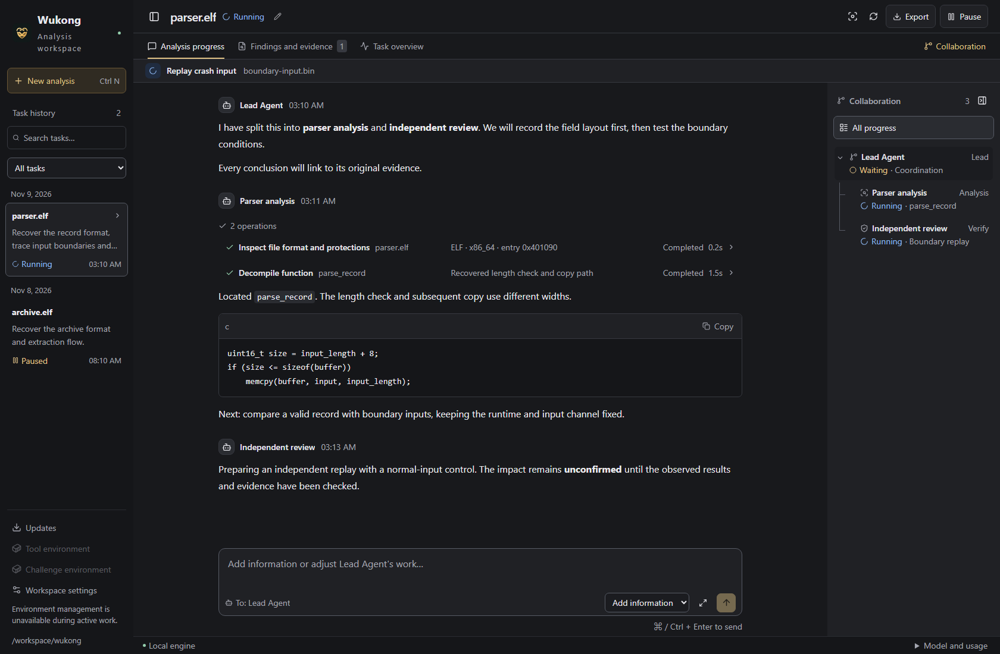
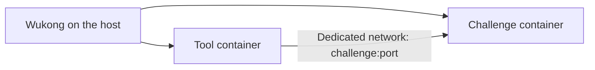

<p align="center">
  
</p>

<h1 align="center">Wukong</h1>

<p align="center">English · <a href="README.zh-CN.md">简体中文</a></p>

<p align="center">
  <strong>A multi-agent workspace for binary reverse engineering and Pwn analysis</strong><br>
  Understand behavior · Recover formats and algorithms · Debug · Verify with evidence
</p>

<p align="center">
  <a href="https://github.com/mark0-cn/Wukong/actions/workflows/ci.yml"></a>
  <a href="rust-toolchain.toml"></a>
  <a href="LICENSE"></a>
</p>

<p align="center">
  <a href="#quick-start">Quick start</a> ·
  <a href="https://github.com/mark0-cn/Wukong/releases">Releases</a> ·
  <a href="docs/user/usage.md">User guide</a> ·
  <a href="docs/README.md">Documentation</a> ·
  <a href="https://github.com/mark0-cn/Wukong/issues">Issues</a>
</p>

Describe a binary-analysis objective in the desktop workspace or CLI. Wukong's lead Agent coordinates scoped analysis tasks and independent review, keeping conversations, tool operations and original evidence available for inspection. The core uses Rust/Rig; the desktop uses Tauri/React.

<a id="workspace-preview"></a>
<a id="工作区预览"></a>

## Workspace preview



*Current interface with illustrative analysis data. The preview shows task history, analysis progress and the collaboration tree; findings and evidence have their own view.*

<a id="目录"></a>
<a id="contents"></a>

[Capabilities](#what-you-can-do) · [Quick start](#quick-start) · [Support](#platforms-and-requirements) · [Pwn environments](#pwn-workbench) · [CLI](#command-line) · [Source builds](#build-from-source)

<a id="features"></a>
<a id="项目特性"></a>

## What you can do

| Workflow | Available capabilities |
| --- | --- |
| Understand a binary | ELF/PE/Mach-O profiles and strings; Ghidra functions, decompilation, instructions and cross-references |
| Recover behavior | Input formats, data layouts, algorithms and state machines; evidence-backed differential checks |
| Investigate Pwn challenges | GDB/MI, interactive processes, AFL++ QEMU, angr, crash replay and minimization; on-demand heap, ROP, format-string and other methods |
| Coordinate and review | Scoped analyst tasks, a parent-child collaboration tree, independent verifier review, shared notes and coverage |
| Resume and deliver | Pause/resume, token/cost budgets, English/Chinese UI and task output; JSON/Markdown/HTML reports with original evidence and SHA256 manifests |

A static hypothesis, reproduced crash, root-cause conclusion and verified impact are recorded as separate stages. Impact claims require independent verification and linked evidence. See the [tool catalog](docs/reference/tool-catalog.md) and [Skill coverage](docs/reference/skill-coverage.md).

<a id="快速开始"></a>
<a id="usage"></a>
<a id="使用方式"></a>
<a id="desktop-workspace"></a>
<a id="桌面工作区"></a>

## Quick start

1. **Get the client.** Use a Windows x64 `-setup.exe` or Linux x64 `.AppImage` when one is listed in [Releases](https://github.com/mark0-cn/Wukong/releases). If no installer is published, follow [Build from source](#build-from-source). See [installation and updates](docs/user/online-install.md) for platform steps.
2. **Prepare tools.** Install/start Docker with Linux-container support, open Wukong and choose **Prepare tool environment**. The published client downloads its version's digest-pinned image from public `hlmark0/wukong`, then runs self-tests. Reserve at least **25 GiB** for Docker images and temporary layers.
3. **Configure a model and analyze.** In **Workspace settings**, choose a provider/model and the credential environment variable name. Set that variable in the launch environment. Select **New analysis**, choose a binary and describe your objective, for example: “Recover the record format and verify the length checks with evidence.”

Published installers include the client; Docker tools download on first use. Source-built versions without a matching official Release use the [manual tool setup](docs/development/getting-started.md#prepare-docker-tools). [Language settings](docs/user/languages.md) independently control the UI and new-task output. Manage subsequent client/tool upgrades through **Updates**.

<a id="支持平台与运行要求"></a>

## Platforms and requirements

| Area | Current scope |
| --- | --- |
| Desktop distributions | Windows x64 NSIS EXE; Linux x64 AppImage, built on Ubuntu 22.04 |
| Static target analysis | ELF, PE and Mach-O |
| Dynamic analysis | Linux x86_64 ELF in Linux amd64 tools; the image also supports running i386 user-space programs |
| Model services | `openai`, `openai_responses`, `anthropic`, `ollama`; credential-free local Ollama is supported |
| Everyday installation | Client, Docker and a configured model service; host Rust/Node.js/Python/GDB are not required for the published Docker-based setup |

macOS has no official desktop installer in this pipeline. Native Windows DbgEng/macOS LLDB, automatic ARM/kernel-Pwn reconstruction and arbitrary Compose topologies are outside current support. Unknown targets run through isolation; `trusted_local` is for trusted development fixtures. Details: [runtime and platform limits](docs/user/pwn-workbench.md#validation-scope-and-limits).

<a id="execution-environment"></a>
<a id="配置执行环境"></a>
<a id="pwn-工作环境"></a>

## Pwn workbench

The host manages tool and challenge containers side by side. Tools keep their own libraries; each challenge retains its runtime files and dedicated network.



Import attachments, build the supplied challenge Dockerfile, prepare binary/libc/loader copies and start the service through the challenge environment. Tools connect to `challenge:port`; their `localhost` refers to themselves. Model credentials stay on the host, and tools receive no Docker socket. Final verification uses the corresponding original challenge environment.

See [Pwn workbench](docs/user/pwn-workbench.md) for Docker challenges, remote relays, debugging, environment checks and migration. The [standalone worker guide](workers/runtime/README.md) covers advanced Docker/SSH/VM deployment.

<a id="命令行"></a>

## Command line

Use the configuration for your prepared workspace when running execution tools:

```sh
# Read a file without executing it or calling a model
wukong inspect ./sample.elf --strings

# Analyze with the generated workbench configuration
wukong --config .wukong/workbench/wukong.toml analyze ./sample.elf --task "Recover the input format with evidence"

# Export to a new directory and check its integrity
wukong report RUN_ID --output ./reports/analysis-01
wukong verify-bundle ./reports/analysis-01
```

Replace `RUN_ID` and the configuration path with your actual values. See [task management](docs/user/usage.md#task-management-and-recovery) for messaging, pause/resume and branch control, or run `wukong --help`.

<a id="1-prerequisites"></a>
<a id="1-准备环境"></a>
<a id="2-clone-and-build"></a>
<a id="2-获取源码并构建"></a>
<a id="3-configure-a-model"></a>
<a id="3-配置模型"></a>
<a id="4-check-and-analyze"></a>
<a id="4-检查环境并开始分析"></a>
<a id="从源码构建"></a>

## Build from source

Install the pinned Rust toolchain, compatible Node.js/npm and Tauri system prerequisites, then:

```sh
git clone https://github.com/mark0-cn/Wukong.git
cd Wukong
npm ci
npm run desktop:build
```

Follow [source setup](docs/development/getting-started.md) for exact prerequisites, CLI-only builds, model credentials and Docker tool preparation. **Download the locked worker attachments before building tool images.** An unpublished client version cannot use online setup until its matching signed release manifest exists.

<a id="文档"></a>
<a id="repository-layout"></a>
<a id="项目结构"></a>

## Documentation

| Guide | Start here for |
| --- | --- |
| [User guide](docs/user/usage.md) | Desktop navigation, model configuration, budgets and recovery |
| [Installation and updates](docs/user/online-install.md) | Installers, first setup, storage, repair and rollback |
| [Pwn workbench](docs/user/pwn-workbench.md) | Tools, challenge services, runtime files and migration |
| [Source setup](docs/development/getting-started.md) | Build dependencies, model setup and source tool images |
| [Configuration example](wukong.example.toml) | All model, budget, worker and tool fields |
| [Architecture](docs/design/architecture.md) / [maintenance](docs/development/maintenance.md) | Repository responsibilities and development checks |

The [full documentation index](docs/README.md) also links tool/Skill references, evidence formats, release workflows, evaluation fixtures and historical records. English guides have complete Chinese counterparts with reciprocal links.

<a id="参与贡献"></a>

## Contributing

Read [AGENTS](AGENTS.md) and [maintenance](docs/development/maintenance.md). Report reproducible bugs through [Issues](https://github.com/mark0-cn/Wukong/issues) or submit a [Pull Request](https://github.com/mark0-cn/Wukong/pulls) targeting `master`. Update both documentation languages together and validate changes according to their impact.

<a id="致谢"></a>

## Acknowledgments

[Strix](https://github.com/usestrix/strix) informed module responsibilities and coordination semantics (baseline `06015506625a78b981ae0b34be40239fc1b389be`). [Rig](https://github.com/0xPlaygrounds/rig) provides model connections, execution, conversation logging and asynchronous subagents. External engines retain their upstream licenses and notices.

<a id="许可证"></a>

## License

[Apache License 2.0](LICENSE). See [NOTICE](NOTICE) for provenance and third-party notices.
