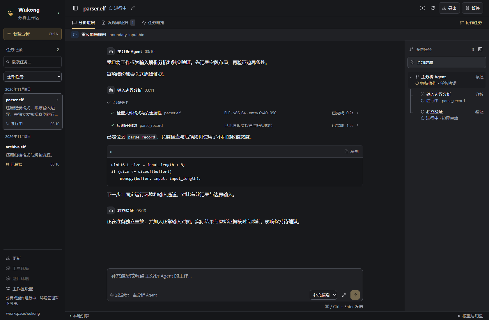
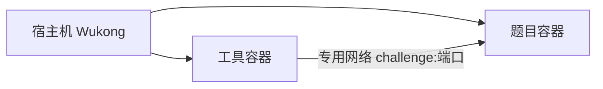

<p align="center">
  
</p>

<h1 align="center">Wukong</h1>

<p align="center"><a href="README.md">English</a> · 简体中文</p>

<p align="center">
  <strong>面向二进制逆向与 Pwn 分析的多 Agent 工作区</strong><br>
  理解行为 · 还原格式与算法 · 动态调试 · 证据验证
</p>

<p align="center">
  <a href="https://github.com/mark0-cn/Wukong/actions/workflows/ci.yml"></a>
  <a href="rust-toolchain.toml"></a>
  <a href="LICENSE"></a>
</p>

<p align="center">
  <a href="#quick-start">快速开始</a> ·
  <a href="https://github.com/mark0-cn/Wukong/releases">发行版本</a> ·
  <a href="docs/user/usage.zh-CN.md">使用指南</a> ·
  <a href="docs/README.zh-CN.md">文档</a> ·
  <a href="https://github.com/mark0-cn/Wukong/issues">问题反馈</a>
</p>

在桌面工作区或 CLI 中描述二进制分析目标，Wukong 的主 Agent 会协调限定范围的分析任务与独立复核，并保留可查看的会话、工具操作和原始证据。分析核心使用 Rust/Rig，桌面使用 Tauri/React。

<a id="workspace-preview"></a>
<a id="工作区预览"></a>

## 工作区预览



*当前界面截图，使用示例分析数据。图中展示任务历史、分析进度和协作树；发现与证据有独立视图。*

<a id="目录"></a>
<a id="contents"></a>

[项目能力](#what-you-can-do) · [快速开始](#quick-start) · [支持范围](#platforms-and-requirements) · [Pwn 环境](#pwn-workbench) · [命令行](#command-line) · [源码构建](#build-from-source)

<a id="features"></a>
<a id="项目特性"></a>
<a id="what-you-can-do"></a>

## 可以完成哪些工作

| 工作流程 | 已有能力 |
| --- | --- |
| 理解二进制 | ELF/PE/Mach-O 画像与字符串；Ghidra 函数、反编译、指令和交叉引用 |
| 还原行为 | 输入格式、数据布局、算法和状态机；有证据关联的差分检查 |
| 调查 Pwn 题目 | GDB/MI、交互进程、AFL++ QEMU、angr、崩溃重放与缩减；按需加载堆、ROP、格式串等方法 |
| 协作与复核 | 限定范围的 analyst 任务、父子协作树、独立 verifier 复核、共享笔记与覆盖记录 |
| 恢复与交付 | 暂停恢复、Token/费用预算、中英文界面与任务输出；包含原始证据及 SHA256 清单的 JSON/Markdown/HTML 报告 |

静态假设、崩溃复现、根因结论和已验证影响分别记录。影响声明需要独立验证及关联证据。详见[工具目录](docs/reference/tool-catalog.zh-CN.md)和 [Skill 覆盖](docs/reference/skill-coverage.zh-CN.md)。

<a id="快速开始"></a>
<a id="usage"></a>
<a id="使用方式"></a>
<a id="desktop-workspace"></a>
<a id="桌面工作区"></a>
<a id="quick-start"></a>

## 快速开始

1. **获取客户端。** [Releases](https://github.com/mark0-cn/Wukong/releases) 中有安装文件时，下载 Windows x64 `-setup.exe` 或 Linux x64 `.AppImage`；尚无安装包时按[源码构建](#build-from-source)操作。平台安装步骤见[在线安装与更新](docs/user/online-install.zh-CN.md)。
2. **准备工具。** 安装并启动支持 Linux 容器的 Docker，打开 Wukong 后选择“准备工具环境”。正式客户端从公开 `hlmark0/wukong` 拉取本版本固定 digest 的镜像并执行自检。为 Docker 镜像和临时层至少预留 **25 GiB**。
3. **配置模型并开始分析。** 在“工作区设置”中选择服务、模型和凭据环境变量名，在启动环境中设置该变量。点击“新建分析”，选择二进制并描述目标，例如：“还原记录格式，并用证据验证长度检查。”

正式安装包包含客户端，Docker 工具在首次使用时下载。没有配套正式 Release 的源码版本使用[手动工具准备](docs/development/getting-started.zh-CN.md#prepare-docker-tools)。[语言设置](docs/user/languages.zh-CN.md)分别控制界面和新任务输出；后续客户端和工具升级通过“更新”完成。

<a id="支持平台与运行要求"></a>
<a id="platforms-and-requirements"></a>

## 支持平台与运行要求

| 项目 | 当前范围 |
| --- | --- |
| 桌面发行 | Windows x64 NSIS EXE；Linux x64 AppImage，在 Ubuntu 22.04 构建 |
| 静态目标分析 | ELF、PE、Mach-O |
| 动态分析 | Linux amd64 工具中的 Linux x86_64 ELF；镜像也支持运行 i386 用户态程序 |
| 模型服务 | `openai`、`openai_responses`、`anthropic`、`ollama`；支持无凭据本地 Ollama |
| 日常安装 | 客户端、Docker 和配置好的模型服务；正式 Docker 安装流程不要求宿主机安装 Rust/Node.js/Python/GDB |

当前流水线没有 macOS 正式桌面安装包。原生 Windows DbgEng/macOS LLDB、自动 ARM/内核 Pwn 环境重建及任意 Compose 拓扑不在当前支持范围。未知目标通过隔离后端运行，`trusted_local` 仅供可信开发夹具。详见[运行环境与平台限制](docs/user/pwn-workbench.zh-CN.md#validation-scope-and-limits)。

<a id="execution-environment"></a>
<a id="配置执行环境"></a>
<a id="pwn-工作环境"></a>
<a id="pwn-workbench"></a>

## Pwn 工作环境

宿主机并列管理工具容器与题目容器。工具保留自己的系统库，每道题保留其运行文件和专用网络。



通过题目环境导入附件、构建题目自带 Dockerfile、准备 binary/libc/loader 副本并启动服务。工具连接 `challenge:port`，其中 `localhost` 指向工具自身。模型凭据留在宿主机，工具不挂载 Docker socket。最终验证回到对应的原始题目环境。

Docker 题目、远程转发、调试、自检和迁移见 [Pwn 工作环境](docs/user/pwn-workbench.zh-CN.md)。高级 Docker/SSH/VM 部署见[独立 worker 指南](workers/runtime/README.zh-CN.md)。

<a id="命令行"></a>
<a id="command-line"></a>

## 命令行

调用执行工具时，使用已准备工作区的配置：

```sh
# 读取文件，不执行目标或调用模型
wukong inspect ./sample.elf --strings

# 使用生成的工作环境配置开展分析
wukong --config .wukong/workbench/wukong.toml analyze ./sample.elf --task "Recover the input format with evidence"

# 导出到新目录并检查完整性
wukong report RUN_ID --output ./reports/analysis-01
wukong verify-bundle ./reports/analysis-01
```

将 `RUN_ID` 和配置路径替换为实际值。消息、暂停恢复及分支控制见[任务管理](docs/user/usage.zh-CN.md#task-management-and-recovery)，或运行 `wukong --help`。

<a id="1-prerequisites"></a>
<a id="1-准备环境"></a>
<a id="2-clone-and-build"></a>
<a id="2-获取源码并构建"></a>
<a id="3-configure-a-model"></a>
<a id="3-配置模型"></a>
<a id="4-check-and-analyze"></a>
<a id="4-检查环境并开始分析"></a>
<a id="从源码构建"></a>
<a id="build-from-source"></a>

## 从源码构建

安装固定 Rust 工具链、兼容的 Node.js/npm 和 Tauri 系统依赖，然后执行：

```sh
git clone https://github.com/mark0-cn/Wukong.git
cd Wukong
npm ci
npm run desktop:build
```

具体前提、仅 CLI 构建、模型凭据和 Docker 工具准备见[源码上手指南](docs/development/getting-started.zh-CN.md)。**构建工具镜像前先下载锁定的 worker 附件。** 未发布的客户端版本需要等到配套签名清单发布后才能使用在线准备。

<a id="文档"></a>
<a id="repository-layout"></a>
<a id="项目结构"></a>
<a id="documentation"></a>

## 文档

| 指南 | 内容入口 |
| --- | --- |
| [使用指南](docs/user/usage.zh-CN.md) | 桌面导航、模型配置、预算和恢复 |
| [在线安装与更新](docs/user/online-install.zh-CN.md) | 安装器、首次准备、存储、修复和回滚 |
| [Pwn 工作环境](docs/user/pwn-workbench.zh-CN.md) | 工具、题目服务、运行文件和迁移 |
| [源码上手](docs/development/getting-started.zh-CN.md) | 构建依赖、模型配置和源码工具镜像 |
| [配置示例](wukong.example.toml) | 全部模型、预算、worker 和工具字段 |
| [架构](docs/design/architecture.zh-CN.md) / [维护约定](docs/development/maintenance.zh-CN.md) | 仓库职责和开发检查 |

[完整文档索引](docs/README.zh-CN.md)还包含工具/Skill 参考、证据格式、发布流程、评测夹具和历史记录。英文指南均有完整中文版本及互跳链接。

<a id="参与贡献"></a>
<a id="contributing"></a>

## 参与贡献

先阅读 [AGENTS](AGENTS.zh-CN.md) 和[维护约定](docs/development/maintenance.zh-CN.md)。通过 [Issues](https://github.com/mark0-cn/Wukong/issues)反馈可复现问题，或向 `master` 提交 [Pull Request](https://github.com/mark0-cn/Wukong/pulls)。同步更新两种文档语言，按实际影响选择验证。

<a id="致谢"></a>
<a id="acknowledgments"></a>

## 致谢

[Strix](https://github.com/usestrix/strix)提供模块职责和协调语义参考，基线为 `06015506625a78b981ae0b34be40239fc1b389be`。[Rig](https://github.com/0xPlaygrounds/rig)提供模型连接、执行、会话日志和异步子 Agent。外部引擎保留各自上游许可证及声明。

<a id="许可证"></a>
<a id="license"></a>

## 许可证

[Apache License 2.0](LICENSE)。来源与第三方声明见 [NOTICE](NOTICE)。
