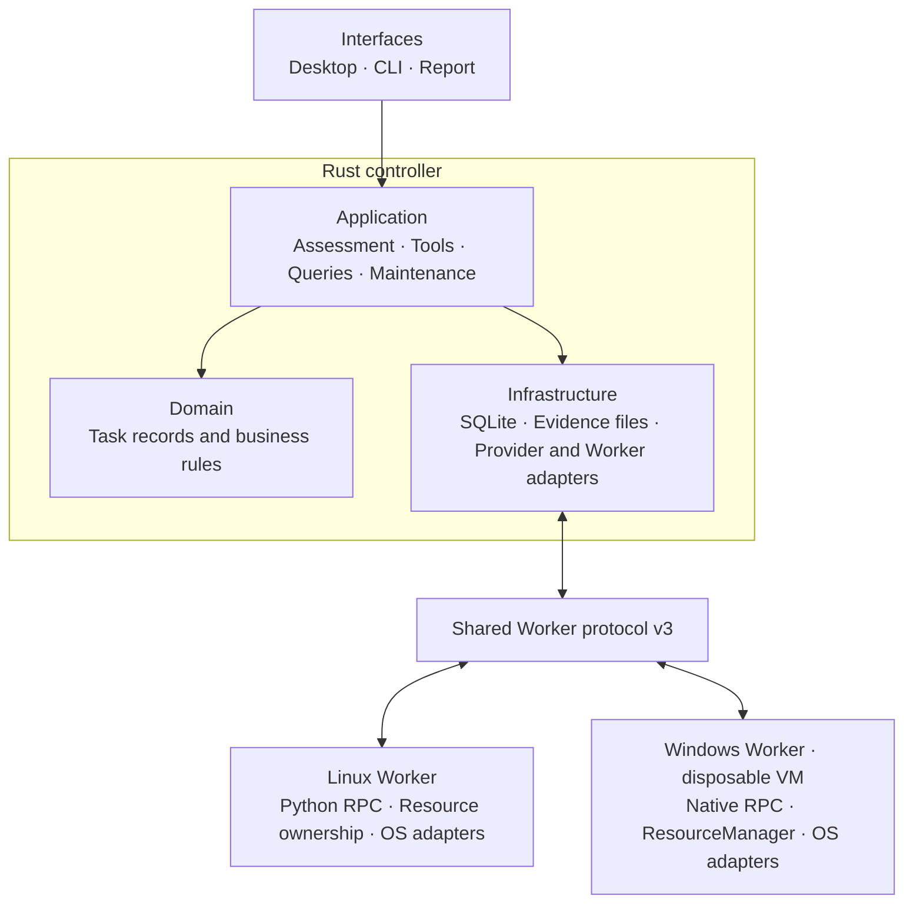
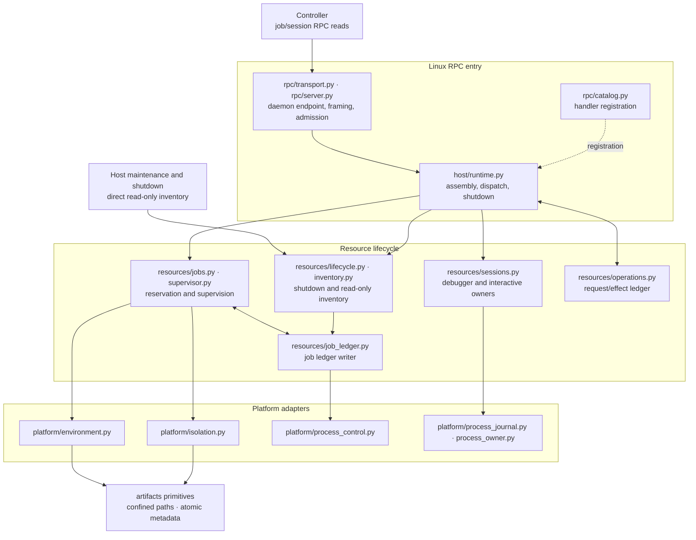
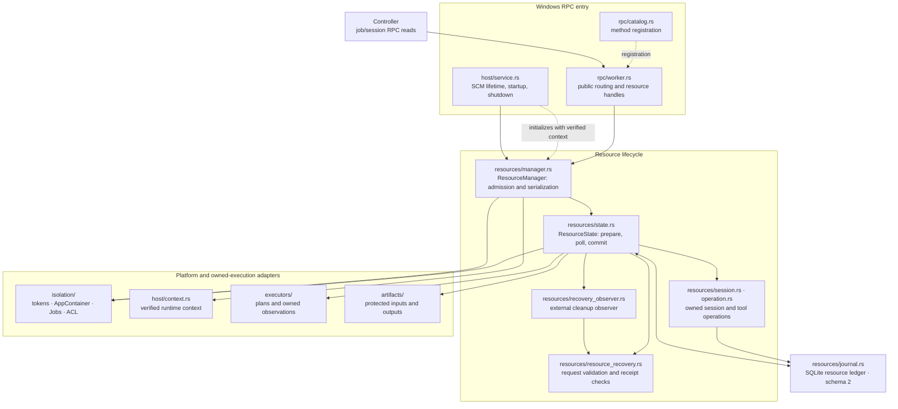

# Rust / Rig binary-analysis Agent architecture

English · [简体中文](architecture.zh-CN.md)

Compacted conversations include a bounded `working_state` rebuilt from the same agent's durable job, file, tool-call and shared-document records. It retains early and recent completed job observations, recent other jobs, file hashes/paths, tool errors and note previews across generations. Each preview retains original evidence/retrieval references and omission counts; a completed job is an observation, not a verified fact. Rig still owns transcript retention and summary replacement. Analysts save concise progress notes after decisive results, and consult original evidence when a preview is incomplete.

This project implements Strix-inspired responsibilities and runtime semantics: root orchestration, dynamic children, messaging, independent conversations, sandboxed tools, Skills, evidence and independent verification. The [original plan](../history/strix-rig-binary-agent-plan.md) is a historical requirements baseline; [implementation contract](implementation-contract.md) records acceptance invariants. The controller is Rust; production execution uses Rig 0.46.0 ECS and native SubagentsPlugin.

## Modules and responsibilities

The [2026-11-15 cleanup acceptance](../history/validation/2026-11-15-architecture-cleanup.md) records the file migration, Python design changes, tested identities and validation limits.

The controller source is grouped by responsibility: `domain` holds durable records and pure rules; `queries` holds neutral read models; `application` owns use cases, agent integration and maintenance; `storage` owns transactions and artifacts; `adapters` owns worker/provider/filesystem integration; `interfaces` owns CLI, desktop and reports. `bootstrap` assembles dependencies. Existing public Rust paths are re-exported centrally in `src/lib.rs`; internal imports use the owning module. Private runner tests remain beside the runner, and installed-worker SSH fixtures live under `src/adapters/worker/ssh/tests`.

The application query facades supply neutral snapshots. Desktop health commands delegate observation to `application/maintenance/updates/health`, and the Windows setup page reads its inventory through `application/windows_worker_setup/inventory`. `interfaces/report/bundle` owns the file manifest and offline integrity checks for exported reports. Desktop job presentation keeps the recorded execution result, resource-cleanup confirmation and blocking reason separate, linking only the evidence references already stored on the job; it never treats a finished execution as cleanup confirmation. The Windows deployment diagnostics likewise read generation records, the installation recovery record, the imported receipt and the current registration in their owning modules, keeping missing, corrupt and unverified states distinct; the desktop only projects the result.

Public execution uses JSON-RPC protocol v3 over SSH/stdio. The independent `workers/protocol` crate owns method identities, request/response types, effects, resource demand and the generated JSON Schema. Rust/jsonrpsee and Python/jsonrpcserver register actual handlers; both validate the same contract corpus. The model-tool catalog owns role visibility and required methods; each worker registry owns its handlers and readiness. Third-party observations remain raw evidence, while file/job/session identities and transport configuration are structured.

Controller connections/configuration/identity/leases live under `src/adapters/worker` and `src/adapters/environments`; `ToolContext` carries a bound worker into file/job/session/verification use cases. `WorkerGateway` retains stable request IDs and unmodified worker receipts. Those use cases translate resource IDs into controller ownership records. `src/application/effects` and `src/storage` retain business receipts, evidence and notifications; the worker's execution ledger separately records external effects. A repeated session-start receipt cannot reopen a closed controller session or erase its transcript.

Windows groups code into `host`, `resources`, `executors`, `artifacts`, `isolation` and `rpc`. `ResourceManager` alone serializes lifecycle admission, reservation and ticket-checked completion. Input preparation, execution waits and recovery run outside its state lock; active work remains owned when a caller disconnects. Explicit active-resource states distinguish startup, execution, finishing, closing and recovery. Executors return observations without writing the ledger. The host injects a verified runtime context; Windows API details stay in isolation. Internal sessions retain Prost/Protobuf.

Windows targets run in a dedicated disposable VM declared in signed enrollment. Hypervisor policy owns host/external-network isolation; guest AppContainer/token/ACL checks remain internal controls, without WFP event collection. Readiness reports explicitly leave external isolation unverified. The operator accepts guest compromise and resets/discards the VM; controller credentials stay outside. See the [Windows boundary contract](../../workers/windows/README.md).

`workers/analysis` is a Python package with explicit inputs and no worker state or transport. Linux adapters retain confinement/live debugging; Windows disposable helpers use the same package. The Windows component inventory excludes Linux worker services/dependencies. Architecture guards live in `tests/automation/test_execution_boundaries.py`.

The controller store requires schema 5, the Windows resource journal version 2 and package manifests schema 2. Older formats/protocols fail closed. Use new workspaces and worker instances for v3; there is no migration, automatic deletion or legacy configuration adapter. Existing directories and evidence stay intact. Current acceptance is recorded separately from historical results.

Worker dependencies are enforced by architecture tests: native core ownership types are independent of artifact storage; RPC routes into resource operations; tool-specific plans and result adapters stay outside lifecycle commits. Python core/platform/execution/debugger/resources/operations follow explicit dependency directions. Both platforms consume a shared lifecycle corpus covering outcome certainty, cleanup and durable retry semantics. See [worker boundaries](../../workers/runtime/README.md#module-boundaries) and [protocol semantics](../../workers/protocol/README.md).

Windows has one native worker authority. The controller owns business tasks/evidence, `workers/protocol` shares public types, and the native service owns capabilities, leases, files and resources. Python on Windows is a disposable isolated analysis tool; Linux retains its Python worker. See [cross-platform environments](cross-platform-environments.md) and the [current Windows component guide](../../workers/windows/README.md).

| Module | Responsibility |
|---|---|
| `domain` | Durable run/agent/message/event/tool/evidence/finding/verification/coverage records |
| `storage` | SQLite transactions, events/mailboxes and content-addressed original artifacts |
| `application/coordinator` | Shared transaction entry; `runs`, `tasks`, `messages`, `waits`, `completion` manage runs, children, mail, dependencies and completion |
| `application/agents`, `prompts/` | Role/capability prompt assembly; `src/application/prompts.rs` owns builtin registration |
| `adapters/models` | Provider configuration and native connections |
| `application/assessment/runner`, `bootstrap` | Run lifecycle and concrete dependency assembly |
| `application/agent_runtime/host`, `application/model_catalog`, `application/usage` | Kernel-facing business APIs, role model selection, usage/budget accounting |
| `application/agent_runtime` | Business integration with Rig execution/logging, child/message protocol, model/tool admission and native conversation projection |
| `application/tools` | One `catalog`; responsibility-grouped `args/`/`handlers/`; services own permissions/resources/evidence; `verification` centralizes independent admission/certification |
| `adapters/binary` | Address identity/SHA256; `profile` parses ELF/PE/Mach-O, `strings` extracts bounded strings, `ghidra` owns headless/cache/process lifecycle |
| `adapters/worker`, `workers/runtime` | Isolation, durable worker, GDB/MI sessions, AFL++ jobs, crash replay/minimization |
| `adapters/mcp` | rmcp protocol, Rig definitions, namespaces, timeouts, environment and message-size limits |
| `interfaces/report`, `interfaces/cli` | Export, CLI, operator queries/intervention |
| `interfaces/desktop`, `ui/src` | Tauri commands/workspace services, presentation adapters and React lifecycle |

### Worker resource boundaries

Workers keep one dependency direction: the RPC entry admits and dispatches requests, the resource lifecycle owns durable resources and their ledger, and platform adapters perform the bounded OS operations. The controller reads resources through RPC status methods or the direct read-only inventory used by maintenance and shutdown; it never writes a worker ledger. `tests/automation/test_execution_boundaries.py` guards these edges and reports the offending file plus the forbidden dependency; annotation-only (`TYPE_CHECKING`) imports and test-only references are excluded, and the documented exceptions below are allowlisted.

| Responsibility | Linux worker (Python) | Windows worker (native Rust) |
|---|---|---|
| RPC entry (implemented) | `rpc/transport.py`/`rpc/server.py` own the daemon endpoint and framing; `rpc/catalog.py` registers callable handlers; `host/runtime.py` assembles services, admits requests and dispatches them through the request ledger, then delegates shutdown to `resources/lifecycle.py`. | `rpc/worker.rs` routes registered methods and holds the resource handle; `rpc/catalog.rs` registers methods; `host/service.rs` owns SCM lifetime, startup, recovery and shutdown and initializes the manager from a verified `host/context.rs`. |
| Resource lifecycle (implemented) | `resources/jobs.py`/`supervisor.py` reserve, start and supervise jobs; `resources/sessions.py` owns debugger and interactive sessions; `resources/operations.py` reserves and reconciles external effects; `resources/lifecycle.py` and the read-only `resources/inventory.py` serve shutdown and maintenance. | `resources/manager.rs` serializes admission, reservation and ticket-checked completion; `resources/state.rs` advances explicit active-resource states; `resources/session.rs`/`operation.rs` own session and tool operations; `resources/resource_recovery.rs` validates recovery requests and receipts. |
| Platform and owned adapters (implemented) | `platform/environment.py`, `isolation.py`, `process_control.py`, `process_journal.py` and `process_owner.py` provide bounded environment, Linux confinement and process identity/journal primitives; `windows_identity.py`/`windows_paths.py` serve trusted Windows fixtures. They may use artifact primitives, never resource services or RPC. | `isolation/` owns tokens, AppContainers, Jobs, ACLs and process launch; `artifacts/` owns protected IO; `executors/` owns plans and owned execution observations; resources depend on these adapters, while executors never write the ledger. |
| Ledger and single writer | Job status is written only by `resources/job_ledger.py`, external effect records only by `resources/operations.py`, and session receipts only by `resources/sessions.py`, with process ownership in `platform/process_journal.py`. `resources/inventory.py` only reads. | `resources/journal.rs` is the only SQLite resource ledger (schema 2); every mutation is serialized by `ResourceManager` through `ResourceState`. `resources/recovery_observer.rs` returns only a `ProtectedReceipt` and names no ledger type; `resource_recovery.rs` verifies the receipt without committing it. |
| Ownership evidence | Durable job records, session receipts and `processes.json` carry boot/namespace and process-creation identity; `inventory.py` treats a resource as settled only when the lifecycle observation and the journal's durable `closed` observation agree, and still discovers a session left with only `processes.json` after an interrupted publication. | Owner identity binds installation, boot, run, owner and epoch; capacity one is enforced by the journal; reservation tickets reject stale completion; cleanup `Cleanup` flags are business preconditions checked alongside OS observations, and recovery accepts only a System-owned receipt bound to the attempt, resource, owner, record digest and cleanup facts. |
| Controller read path | RPC read methods route through `host/runtime.py` to resource-service status queries; host maintenance and shutdown probe `workbench/control.py` → `resources/inventory.py` directly. The controller never writes these records. | RPC status/list queries route through `rpc/worker.rs` to `ResourceManager`/`ResourceState` reads over the journal; host startup and keep-alive poll the same state. The controller never opens the native ledger or resource files. |
| Manual verification required | Changing shutdown ordering, session ownership or the inventory judgement requires `python workers/tests/run.py unit -p 'test_*.py'` plus the affected Linux acceptance; adding or moving a guard exception needs an explicit direction review. | Changing the journal, manager, recovery observer or receipt verification requires Rust checks and native acceptance on a disposable VM or hosted runner; static guards cannot prove OS cleanup, crash recovery or receipt authenticity. |
| Implemented now | RPC entry → resource lifecycle → platform adapters → artifacts; `resources/**` imports no RPC/transport entry module and `platform/**` imports only artifact primitives. | RPC entry → `ResourceManager` → `ResourceState`/`Journal`; resource lifecycle → isolation/artifacts/executors/host context; the cleanup observer cannot name ledger types. |
| Remaining exceptions | None in the guarded production graph. Worker tests under `workers/tests/` may import any layer as fixtures, and `rpc/catalog.py` keeps a `TYPE_CHECKING`-only reference to `host/runtime.py`. | `resources/journal.rs` calls `crate::rpc::worker_identity::validate` and `crate::rpc::pipe_transport::service_name` before opening the journal; these are binding/transport identity helpers rather than the dispatch entry and are the guard's only allowlisted symbols. Test-only `crate::rpc` references in `resources/session.rs` and `resources/state_tests.rs` are not production dependencies. |

The guards are static: they prove imports and symbol references, not runtime ownership, cleanup or receipt authenticity. The mermaid diagrams are illustrative; the guard test and production code are authoritative. Adding a genuinely required cross-layer edge means updating the guard's documented exception list and this matrix in both languages during review.

## A run's lifecycle

1. Import the target, record full SHA256/path/configuration, and create the root run/Agent.
2. Root invokes native `task` with description, prompt, role, scope and optional contract. Business persistence creates the task transactionally; Rig creates the asynchronous child and returns. Role/scope deduplication applies. Unfinished predecessors block only the child's model request, not its creator.
3. Each Agent owns a native Conversation. AgentPlugin drives model/tool effects; SessionLogPlugin stores recoverable logs; EffectLogPlugin stores effects. SQLite holds the business ledger and CLI/GUI conversation projection. Concurrency counts in-flight model requests; waiting parents consume no model slot.
4. SubagentsPlugin owns creation, requests, reports and cancellation. `wait` awaits one reachable Agent; `wait_for_agents` adds business success conditions. Completion is deduplicated per generation and bound to one native Report. Information does not release waits; new work after completion requires `follow_up_agent`.
5. Schemas/validation reuse Rig. Original results become evidence; models receive bounded original results and evidence IDs without secondary model summarization. The host preserves identity/status. General analysis enters shared notes/todos/coverage; threat models are optional for security-boundary work.
6. Conversation retention, tool pairing and summary replacement reuse rig-memory, retaining shared-document/original-conversation evidence references. Inheritance copies only closed parent turns, never fabricating results for unresolved calls. Retries use Rig classification/Retry-After, costs use Rig Pricing, and business rules retain budget pauses.
7. Confirmed impact requires an independent verifier record. `agent_finish`/`finish_scan` pass business contract/evidence/session-cleanup gates before native completion reporting; ordinary prose cannot bypass them.

## State and recovery

`TaskGraph`, `DependencyRules`, `CompletionRules`, `MessageRules` are pure domain rules independent of storage/execution. Coordination loads facts, applies rules and commits task/mail changes in one transaction; queries/generation archives remain in transaction-session implementations.

Agent states: queued, running, waiting, budget_paused, completed, stopped, crashed, failed. Completion/stop notify parents. Budget pauses retain checkpoints and resume scheduling later. During each controller epoch, the supervisor sends Root one durable `budget_finalization` notice when the wall-clock reserve begins (one quarter of the wall budget, bounded to 1–30 seconds). The notice wakes a parked Root without clearing its dependency condition or completing descendants; it requests reconciliation and `finish_scan`, not new work. It does not waive completion gates or replace the hard wall pause, and a resumed controller epoch can issue a fresh notice.

Within an active run, `follow_up_agent` (desktop **Assign follow-up**) adds work to a completed child, preserving history/cumulative usage and starting a new generation. Calls/notices are generation-scoped. Completed parents are awakened too; stopped/failed branches need new tasks. Explicit predecessor dependencies combine with parent-completion dependencies; ancestor dependencies/indirect cycles are rejected.

Children close owned debug/interactive sessions before finishing; root resolves all sessions. Other Agents in the same run may close abandoned sessions of stopped/failed owners, but cannot issue debug commands/interactive input.

Native logs in `state_dir/rig/RUN_ID` contain model conversations, effects and provider metadata, not clients/credentials. Resolved provider/endpoint configuration is pinned before first model I/O and reused on resume. Per-role request output budgets do not overwrite model capacity. Keys use configured environment variables. Fresh tasks use schema 5; old databases/custom AgentRun checkpoints are not migrated.

`DurableEffects` centralizes admission, stable identities, transactional/worker receipts and recovery. Business call IDs combine Agent, generation, metered model turn and provider tool-call ID, not reassigned ECS IDs. Business state/receipts commit together. Worker replies persist before controller postprocessing; missing replies are reconciled using the same request ID against the durable worker ledger. Uncertain MCP writes remain for operator reconciliation, never automatic replay. Operator reconciliation also uses epoch leases. Native effects/database changes wake execution.

`KernelHost` exposes concrete business operations to Rig; the kernel does not access Store, Coordinator, ToolService or full configuration. `ModelCatalog` owns resolved role models; `UsageService` atomically updates budgets/usage; `bootstrap` creates concrete clients/services.

`RunSupervisor` independently manages controller leases, duration budgets and background worker observation; Rig frames do not await worker RPC. Leases carry persistent increasing versions. Runner/coordinator/tools share versioned store handles; every write transaction validates owner/version/expiry before mutation. Expired controllers stop and late results cannot overwrite a successor. Supervision ends with run completion/cancellation; lease release also checks version.

The desktop and CLI use `AssessmentService` for assessment start/resume; the desktop additionally uses it for pause, stop and operator messages. `PreparedAssessment` retains resolved configuration/event subscriptions and closes controller tool connections on success/error. Frontends do not orchestrate leases or construct resume configuration. Resume preparation does not mutate tasks; budget changes commit only after the supervisor acquires the lease.

`ToolContext` explicitly assembles execution, analysis, coordination, document, evidence and environment services without dereferencing to `ToolService`. Catalog adapters pass each handler its concrete service; handlers cannot reach the complete entry point. The catalog still owns schemas, registration, permissions and recovery policy, and Rig retains generic scheduling. `FilesService`, `JobService` and `SessionsService` own worker use cases; `WorkerGateway` centralizes transport/stable receipts. Controller ownership uses `JobRecord`, `SessionRecord`, `WorkerFileRecord`, `RunScoped`; original worker extension payloads remain JSON.

`JobService::observe` unifies automatic and manual status queries, checks ownership and imports only original status evidence. It serializes each resource and merges the latest record. A fair observer shares resource identities across job observation and session cleanup: at most eight requests globally and two per environment, ten-second observation deadlines, and per-resource failure backoff from one to thirty seconds. Successful observations reset backoff. Controller heartbeats and environment lease renewal remain independent; every late write must pass the controller fence. Cleanup retains the first durable operation identity across manual calls, timeout and restart.

`EvidenceSyncService` transfers outside the resource lock, with two tasks globally and one per worker environment. It persists the manifest and per-file progress keyed by worker identity, path, SHA256 and size; verified files survive restart without redownload. Network failures retry with bounded backoff; integrity/size failures remain explicit failures. Publication reacquires the resource lock and checks the current identity and controller fence. Status queries and working context show bounded progress and errors.

The first terminal observation transactionally delivers `job_execution_finished` with original evidence, cleanup and synchronization state. It cannot authorize business success. Only confirmed cleanup, complete evidence and completed postprocessing permit the existing `job_completed` notification. The two phases deduplicate separately; unacknowledged mail survives restart and old-generation notices become stale. Verifier certification and root success require evidence readiness; unavailable evidence may instead support an explicit inconclusive result with gaps. `lost` remains terminal; exit/verification flags come from `result`. Additive controller fields have defaults: existing complete artifact records remain ready and existing final notifications do not receive a backfilled first phase. Worker protocol v3, tool names and permissions are unchanged. RPC `error.data.kind` retains typed recovery categories.

Runtime roles are only `root`, `analyst`, `verifier`. Root decomposes/dispatches/coordinates/delivers; analysts inspect targets; verifiers independently check other instances. Child `role` accepts only analyst/verifier. Roles determine models, budgets and permissions; Skills grant none.

`recon`, `reverse`, `hunter`, `fuzz`, `crash`, `exploit`, `reporter` are capabilities; `formats`, `types`, `algorithms`, `state_machine`, `binary_diff` and others are methods. An analyst may switch methods within scope without creating successor tasks solely for capability changes. Active same-scope analysts share deduplication; independent verifiers may use that scope separately. Hunters may start from a bounded research scope without a predetermined vulnerability hypothesis. Root handles ordinary reporting; delegate a reporter analyst only for large report artifacts.

Controller-installed role instructions cannot load as extra Skills. `load_skill` saves the local body/SHA256/original evidence as an active instruction snapshot, effective in the next fresh model request. Frozen requests remain unchanged; source edits do not mutate loaded snapshots. A same-name active snapshot replaces its initial body. Dynamic instructions are added directly to the request and survive compaction/recovery. Limit: 64 KiB per Skill, at most five distinct initial/dynamic names combined. Capabilities add methods/evidence/artifacts; the primary role owns completion. Successful recovery continues the original task.

`prompts/base.md` contains shared rules; `roles/` identity/lifecycle; `capabilities/` specialist abilities; `methods/` techniques; `support/` tools/recovery; `examples/` substantive demonstrations. `src/application/prompts.rs` registers names/categories/purposes/bodies/optional examples, deriving discovery, loading, errors and role-Skill restrictions. Discovery includes only names/purposes; bodies/examples assemble by role/selection. Redundant short fuzz/crash examples were removed.

Callable names remain `reverse`, `hunter`, etc., without directories. Flat `skills_dir/<name>.md` files override/add bodies; `demos_dir` defaults to `prompts/examples` or a custom flat directory. Missing directories skip examples; embedded builtin bodies do not need runtime repository files.

Each fresh model request selects at most six bounded shared-note/todo/optional-threat-model previews by author, parent, predecessor, scope and keywords. This heuristic does not guarantee full relevance coverage; prompts report omitted counts/search entry points. `context_search` supports text, kind, author scope, agent_id and pagination; `context_read` reads original document JSON including amendments by Unicode character offset. Both shrink pages to output-byte limits and retain continuation offsets. Reads stay within the run; `evidence_read` retrieves original evidence. Compaction retains the same previews, ledger counts and full-conversation references, never reinjecting every document/tree. Contracts still define plans/constraints; selection does not replace acceptance.

`src/application/tools/catalog.rs` owns tool schemas, role boundaries and backend requirements. Before each model request, environment preflight intersects observed capabilities with persisted optional group selections; root stays lazy. `tool_catalog` reports availability and `tool_select` changes exposure without changing roles. Core and resource lifecycle tools remain visible; configured MCP tools require the external group. Rig exposes `task`; typed messaging and waits use `send_message_to_agent` and `wait_for_agents`. Root completes through `finish_scan`, children through `agent_finish`, both with a single structured result. Invocation rechecks role, target identity, evidence, resource ownership and backend capabilities. Only verifier may certify independent analysis or impact. Generate the [tool catalog](../reference/tool-catalog.md) with the developer-only `cargo run --example export_catalogs -- tool-catalog`; `--json` exports schemas.

`prompts/coverage.json` associates method sources/tools/mechanism fixtures with `SkillManifest`; `cargo run --example export_catalogs -- skill-catalog` generates [coverage](../reference/skill-coverage.md). Metadata does not change permissions, availability or completion gates.

Worker entry, transport, ledger, jobs, independent supervision, debugging, interaction, files and command execution are separate components. `Runtime` only assembles/routes; the ledger executes callbacks/reconciles session liveness independently of a concrete runtime.

Named [analysis environments](cross-platform-environments.md) connect lazily and bind immutably to child tasks. Resource identities include the worker; shared artifacts move through hash-verified controller storage with bounded resumable transfers.

External processes recover separately from model state. Reconcile debugger/fuzz/job liveness; saved PIDs/SQLite do not prove survival. Reuse completed effects; never blindly replay uncertain ones. MCP readOnlyHint follows Rig hint semantics and does not authorize uncertain remote replay. GDB mutation is owner-serialized; parallel experiments use separate processes. The native kernel registers only allowed business tools, not host shell/general coding tools.

## Desktop reads and persistence boundaries

`interfaces/desktop/configuration` applies scalar or nested-table settings edits to a temporary document, then parses the complete result before replacing the draft. Invalid edits leave the draft unchanged. Saving preserves unrelated comments, checks external file changes and validates the resolved configuration; registering an environment does not connect to it or create its SSH credentials.

`queries` contains neutral read models, incremental cursor state and workspace snapshot inputs. `application/queries` owns the Store-backed `AssessmentQueries`, `FindingQueries` and `ReportQueries` facades. SQL lives in `storage/queries/workspace_delta`/`storage/queries/report`. CLI/GUI share query models; chat parsing/layout caches remain GUI adapters.

The desktop requests a workspace snapshot through `AssessmentQueries::workspace_snapshot`. The storage implementation reads run/Agent summaries, calls, jobs, events and public replies in one SQL transaction. `interfaces/desktop/workspace` projects that frozen snapshot into transcript and active-tool DTOs after the transaction ends, without additional queries or Worker RPC. Response signatures combine epoch, `entity_revisions`, event sequence, query scope and operator mail; unchanged data is not resent, while independent CLI changes remain observable. Active history defaults to latest 500, expandable to 10,000; only calls referenced by that window load. `useWorkspace` rejects stale responses and reloads after task/storage changes.

Business writes use `StateSession`, not exposed SQLite connections. Storage `StoredRecord` binds entity type/location/identity/conversation policy. Business code uses `load`, `records`, `save_record`, typed document/conversation categories and specific result-archive operations. Message replacement, old-generation archives and unread counts remain encapsulated. Receipts/state share lease validation and one IMMEDIATE transaction.

SQLite uses WAL, independent read-only connections and one writer. Reads see consistent transactions; writes remain IMMEDIATE. Indexes cover run/Agent/event-kind/sequence queries. `entities` Agent JSON contains metadata only; `agent_conversations` separately stores checkpoints/inherited history/revisions. Budgets/state neither read nor rewrite conversations. Full reads combine them for inheritance, follow-ups, reports and recovery checks; native Rig logs still drive execution recovery.

`AgentMetadata` excludes checkpoints/history and is the metadata read/write type. `AgentConversation` is the optional conversation payload. `AgentSnapshot` explicitly combines them for inheritance/recovery/reports/chat. Full snapshots use flat JSON; hot paths use metadata.

`interfaces/desktop/presentation` combines public progress/operator messages/tool results into DTOs. Frontend `Conversation` uses assistant-ui and virtualization. `ui/src/shared/api/commands.ts` maps command names/arguments/results; `bridge` invokes them. Type checking does not replace Rust permission/epoch validation. `useDesktopLifecycle` handles close confirmation/native drops/keyboard listeners; `useStartupUpdates` handles startup checks. Styles retain fixed import order with separate color/layout/component ownership. See [maintenance](../development/maintenance.md) for boundaries/benchmarks.

## Addresses and static analysis

Address references carry sample SHA256 and file_offset, module_relative or runtime space. Runtime references also identify run instance/load_base. module_relative starts at the profile's image_base; file offsets are not debugger virtual addresses.

Rust `object` parses actual ELF/PE/Mach-O architecture, width, endianness, sections, symbols, dependencies and imports. Mach-O `LC_MAIN` file offsets map to module addresses before module-relative output. Inputs/lists/strings are bounded; overflow/parse errors are explicit.

Mitigations report enabled, disabled, partial, unknown with raw basis: ELF program headers/dynamic flags, PE DLL characteristics, Mach-O header flags. Canary symbols prove symbol presence, not universal function protection; static ASLR flags do not establish OS runtime policy. Uncertainty remains unknown.

Ghidra uses real headless import/analysis and a Java bridge. Functions use the function manager; decompilation uses `DecompInterface`; xrefs use the reference manager. Analysis timeout, no functions, decompilation failure and hash mismatch are errors. Full decompilation is a separate `.c` artifact.

Cache identity includes target SHA256, Ghidra version/configuration and launcher/bridge hashes. First import persists a project; later queries use `-process -noanalysis`. File locks enforce one writer; each request retains parameters, response, stdout/stderr. External/register/stack addresses retain Ghidra spaces, never pretend to be module-relative.

## Dynamic verification and evaluation limits

`application/tools/verification` centralizes admission/evidence certification; `jobs` owns general query/artifact import. `verification_protocol` types worker identity, counts, network bindings and per-attempt observations. Full original JSON remains evidence; valid types do not establish impact. Network-binding extensions participate in identity comparison rather than discarding unparsed constraints.

Record static hypotheses, crash reproduction, root cause, exploitation primitives and final impact separately. Replay binds target hash, arguments, input and environment. Minimization reruns predicates, never substituting input length or a string for actual reproduction.

`fixtures/` contains symbol/stripped vulnerable, fixed and normal samples. Builders generate ELF; behavior harnesses replay and save hashes/exits. Accuracy uses independent reports/explicit review labels, not crashes as Agent success. See [fixtures](../../fixtures/README.md).

Production dynamic tools default to Linux x86_64 ELF; PE/Mach-O static profiling works in every environment. With a registered Windows environment, the native worker drives an external WinDbg MCP backend for x64/x86 launch/minidump debugging, process and interactive execution, crash replay and input minimization. Installed-worker acceptance covers those trusted-fixture paths and service-restart recovery, but the reports record `production_execution=false`: trusted-fixture acceptance is not production admission or distribution ([v3 record](../history/validation/2026-11-15-execution-contract-v3.md)). Offline media are still built and signed manually, desktop media preparation is unfinished, and hypervisor isolation is configured outside the worker, which reports `external_isolation_verified=false`. Windows advertises no AFL/QEMU, raw debugger command, core snapshot, ELF runtime preparation or symbolic execution; `poc_verify` there replays argv/stdin only, and mapped module contents cannot be confirmed from paths. `artifact_validate` remains Linux-only. macOS LLDB is not implemented. See [analysis environments](cross-platform-environments.md). Current platform acceptance follows CI and [desktop update validation](../development/desktop-updates.md); historical native-kernel checks do not establish current Windows Docker Desktop coverage. Missing dependencies produce explicit errors. Local protocol tests do not establish live-provider/engine acceptance.

## Typed coordination messages

Messages carry kind, correlation/reply IDs, recipient generation, sender generation,
current task identity and evidence references. `send_message_to_agent` defaults to
information: it neither reopens completed work nor interrupts a wait. Questions,
replies, results and blocked notices can interrupt a waiter without erasing its
wait condition. Only explicit `follow_up_agent` reopens completed work.

`queued` means durably enqueued; `included` means accepted into the native
conversation/context and journal, not that a model request ran or acted on it.
`replied` records an explicit
correlated reply (not an assessment of correctness). Old-generation replies are
retained as `stale` and never injected as current work. `message_status` exposes
these states. In-flight model requests keep their original mailbox snapshot.
This increment uses a fresh schema 5 store; no old-database migration is provided.
Informational mail left on completed work becomes
stale when a new generation starts. GUI operator input defaults to information;
the explicit follow-up option reopens completed work.

The native `message` tool opens a request or sends a reply to a reachable active
agent. Use typed `send_message_to_agent` for informational updates and correlated
mail, and `follow_up_agent` for additional work after completion. Native wait
delivery and typed mailbox receipts are projected together; receipt inclusion
does not prove that the model processed or answered the message.

## Task contracts and results

`task.contract` optionally declares an objective, input evidence IDs,
constraints, required named deliverables and completion-condition labels. A task
without extra requirements uses its task text as the objective.
The contract is installed in the specialist prompt and survives checkpoints.
An active role/scope cannot silently be reused with a conflicting contract.

`agent_finish`/`finish_scan` accept `result`: outcome (success, inconclusive,
blocked, cancelled), answer, evidence IDs, named evidence artifacts, completed
condition labels, unknowns and next actions. Summary-only completion is a shorthand
for tasks without required artifacts or conditions. Success checks required artifact names, linked raw
evidence integrity and explicit coverage of declared conditions. These are
completeness/provenance checks, not proof that a model's conclusion is correct.
Non-success outcomes must identify unknowns or next actions and may omit missing
outputs. Cancelled work becomes stopped; blocked/inconclusive completion records
retain their distinct outcome for dependency evaluation.

Results are attached to the terminal notification and agent graph, and archived
per task/agent ID and generation in exported `snapshot.task_results`. A follow-up
clears the current result without deleting the archived previous generation.
The existing agent ID is the task identity in this increment; independent task
assignment/worker attempts remain a later extension.

## Dependency admission and waits

New children default to `dependency_policy=all_success`. `all_terminal` admits a
collector after every prerequisite ends, including failures. `any_success` admits
an alternative consumer after one succeeds and blocks only when all alternatives
end without success. A success requires completed execution plus a success task
result; inconclusive/blocked results do not qualify. Missing prerequisites are
errors, never assumed successes.

Before model scheduling, a transaction either releases the gate or records a
blocked result, fails the unstarted child, archives its result and notifies the
parent. Released models receive the predecessor results in their request context.
Failure propagates through dependent children without model calls. The
release event records producer generations/outcomes; once admitted, later producer
follow-ups do not revoke the consumer. New dependent work evaluates the latest
producer result. This is admission ordering, not automatic live dataflow: required
input evidence still belongs in the task contract.

`wait_for_agents.policy` defaults to all_terminal and also supports all_success
and any_success. Its return/wakeup includes a condition with state pending,
satisfied or blocked, separate from timeout. Both creation gates and runtime wait
edges join the parent-completion dependency graph; cyclic waits are rejected
transactionally. Wait parking and tool receipts commit together, so replay cannot
park the same turn a second time after a lost response.

The desktop transcript projects persisted calls, worker jobs and bounded public model replies. `application/progress` stores public snapshots using existing transaction/revision notifications; the kernel reads Rig `Partial.text` and delegates persistence through `KernelHost`. Rig retains streaming/retry ownership. Reply identity uses agent/generation/metered turn, not ECS entity IDs; late generations/turns cannot replace newer replies. Start/final events reference one reply while intermediate snapshots replace its record. Lease expiry participates in desktop revisions and marks unfinished text interrupted. Public text is presentation only and never releases completion or evidence gates.
