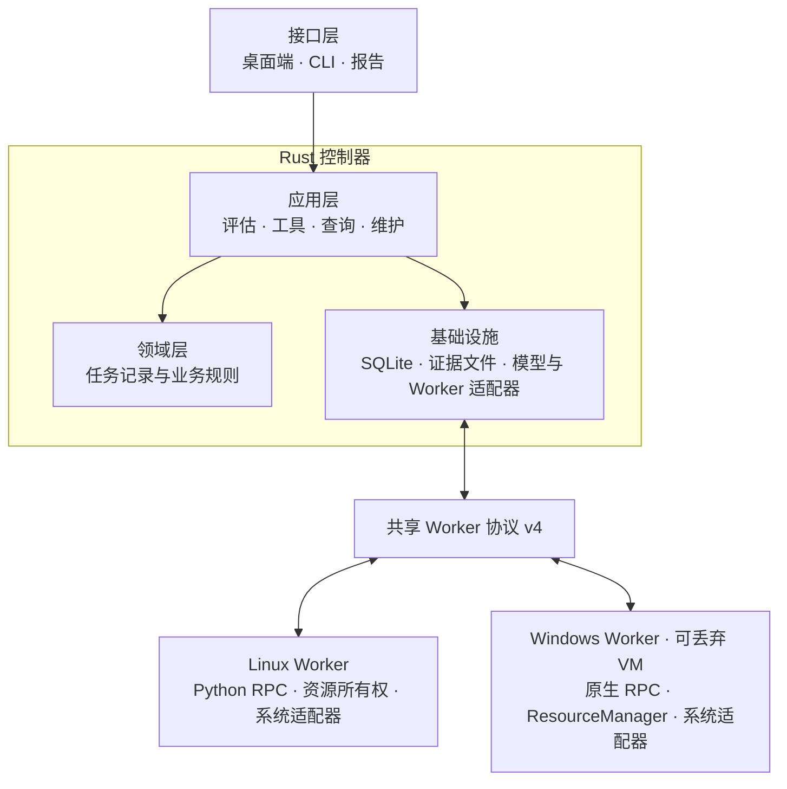
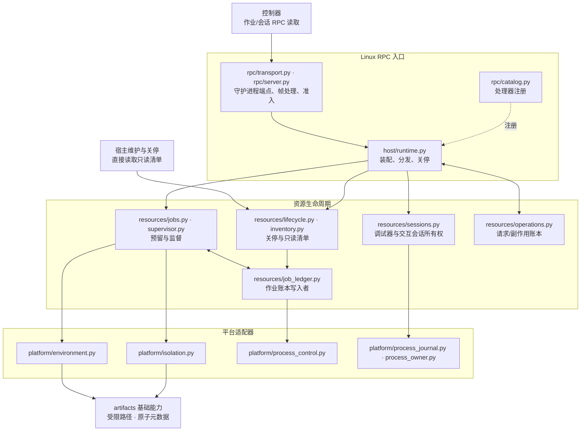
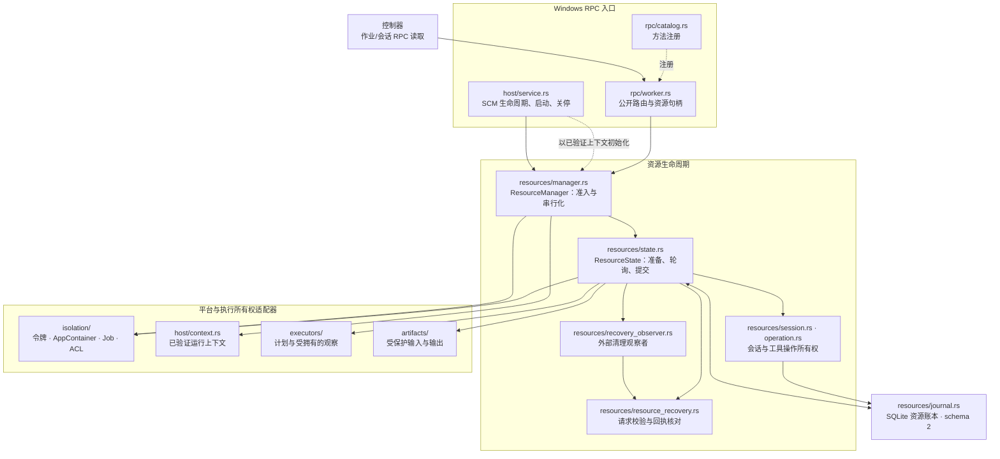

# Rust / Rig 二进制逆向 Agent 实现架构

[English](architecture.md) · 简体中文

压缩后的对话包含有界的 `working_state`，由同一 Agent 的持久作业、文件、工具调用和共享文档记录重建。它跨代保留早期及近期已完成作业的观察、近期其他作业、文件哈希与路径、工具错误和笔记预览。预览保留原始证据／检索引用和省略计数；作业完成只是观察，不等于事实已验证。对话保留与摘要替换仍由 Rig 负责。分析师在关键结果后及时保存简明进度笔记，预览不全时回读原始证据。

本项目按 Strix 的模块职责与运行语义重建：根 agent 编排、动态子 agent、消息、独立会话、沙箱工具、skills、证据与独立验证。[原始方案](../history/strix-rig-binary-agent-plan.zh-CN.md)是历史需求基线，[实现契约](implementation-contract.zh-CN.md)记录验收不变量。控制端使用 Rust，生产执行循环固定使用 Rig 0.46.0 的 ECS 内核及原生 SubagentsPlugin。

## 模块与职责

[2026-11-15 整理验收](../history/validation/2026-11-15-architecture-cleanup.zh-CN.md)记录了文件迁移、Python 设计变更、受测身份及验证限制。

控制器源码按职责归组：`domain` 保存持久记录和纯规则，`queries` 保存中立读取模型，`application` 管理用例、Agent 集成和维护，`storage` 管理事务与制品，`adapters` 管理 Worker/模型提供方/文件系统接入，`interfaces` 管理 CLI、桌面和报告。`bootstrap` 装配依赖。现有公开 Rust 路径集中在 `src/lib.rs` 重导出，内部导入直接指向所属模块。runner 的私有测试与实现相邻，已安装 Worker 的 SSH 夹具位于 `src/adapters/worker/ssh/tests`。

应用层查询入口提供中立快照。桌面健康命令将观测交给 `application/maintenance/updates/health`，Windows 安装页面通过 `application/windows_worker_setup/inventory` 读取清单。`interfaces/report/bundle` 管理导出报告的文件清单和离线完整性校验。桌面任务展示层分别呈现记录的执行结果、资源清理确认和阻塞原因，只关联任务记录中已有的证据引用，绝不把执行结束当作清理确认。Windows 部署诊断同样由各记录所属模块读取生成记录、安装恢复记录、已导入回执和当前登记状态，并区分缺失、损坏与未校验；桌面只投影结果。

公开执行通过 SSH/stdio 使用 JSON-RPC 协议 v4。独立 `workers/protocol` crate 负责方法标识、请求/响应类型、副作用、资源需求及生成的 JSON Schema。Rust/jsonrpsee 和 Python/jsonrpcserver 注册实际处理器，双方校验同一组契约样本。模型工具目录负责角色可见性和所需方法，各 Worker 目录负责处理器及就绪状态。第三方观察保留为原始证据，文件/作业/会话身份与传输配置使用结构化类型。

控制器连接、配置、身份及租约位于 `src/adapters/worker` 与 `src/adapters/environments`；`ToolContext` 将已绑定 Worker 传给文件、作业、会话和验证用例。`WorkerGateway` 保留稳定请求 ID 及未改写的 Worker 回执，由相应用例将资源 ID 转成控制器归属记录。`src/application/effects` 和 `src/storage` 保存业务收据、证据及通知，Worker 执行账本另行记录外部副作用。重复的会话启动回执不能重新打开控制器已关闭的会话，也不能抹掉其 transcript。

Windows 按 `host`、`resources`、`executors`、`artifacts`、`isolation` 和 `rpc` 分组。`ResourceManager` 统一串行处理生命周期准入、预留和核对票据后的提交。输入准备、执行等待与恢复在状态锁外运行，调用方断开后活动操作仍保有归属。显式活动资源状态区分启动、执行、收尾、关闭与恢复。执行器返回观察结果，不写账本；宿主注入已验证运行上下文，Windows API 细节保留在隔离层。内部会话继续使用 Prost/Protobuf。

Windows 目标运行在签名部署记录声明的专用、可丢弃 VM 中。宿主／对外网络隔离由虚拟化层策略负责；guest 内部保留 AppContainer／令牌／ACL 检查，不再收集 WFP 事件。就绪报告明确说明外部隔离未验证。操作者接受 guest 被影响并重置／丢弃 VM；控制器凭据留在外部。参见 [Windows 边界契约](../../workers/windows/README.zh-CN.md)。

`workers/analysis` 是只接收明确输入、不拥有 Worker 状态或传输的 Python 包。Linux 适配器保留文件约束和真实调试，Windows 一次性辅助程序使用同一分析包。Windows 组件清单排除 Linux Worker 服务及依赖。架构检查位于 `tests/automation/test_execution_boundaries.py`。

控制器存储要求 schema 5，Windows 资源账本要求版本 2，包清单要求 schema 2。旧格式或协议直接拒绝；v4 使用新工作区和新 Worker 实例，不提供迁移、自动删除或旧配置适配层。现有目录及证据保持原样。当前验收与历史结果分别记录。

Windows 的执行管理入口只有原生 Worker。控制器负责业务任务和证据，`workers/protocol` 共用公开类型，原生服务负责能力、租约、文件和资源。Python 在 Windows 上作为一次性隔离分析工具；Linux 保留 Python Worker。详见[跨平台环境架构](cross-platform-environments.zh-CN.md)和[当前 Windows 组件指南](../../workers/windows/README.zh-CN.md)。

架构测试约束 Worker 依赖：原生核心所有权类型独立于制品存储；RPC 路由为资源操作；工具专属计划和结果适配位于生命周期提交之外。Python core/platform/execution/debugger/resources/operations 遵守明确依赖方向。两种平台读取同一生命周期样本，覆盖结果确定性、清理和持久重试语义。参见 [Worker 边界](../../workers/runtime/README.zh-CN.md#模块边界) 和 [协议语义](../../workers/protocol/README.zh-CN.md)。

| 模块 | 职责 |
|---|---|
| `domain` | run/agent/message/event/tool/evidence/finding/verification/coverage 的持久化记录 |
| `storage` | SQLite 事务、事件与邮箱、按内容哈希保存的原始产物 |
| `application/coordinator` | 共享事务入口；`runs`、`tasks`、`messages`、`waits`、`completion` 分别管理运行、子任务、消息、依赖等待与完成 |
| `application/agents`、`prompts/` | 角色与能力提示词装配；`src/application/prompts.rs` 统一维护内置目录 |
| `adapters/models` | provider 配置与原生连接 |
| `adapters/telemetry` | 进程持有的 trace、低基数 metric、精选可选 log/JSONL、有界 Worker relay 与关闭 |
| `adapters/observability` | 只读持久本地活动、独立降级的 Tempo/Loki/Prometheus 查询及经过校验的 Grafana 链接 |
| `application/assessment/runner`、`bootstrap` | 运行生命周期与具体依赖装配 |
| `application/agent_runtime/host`、`application/model_catalog`、`application/usage` | 内核可调用的业务接口、角色模型选择、用量及预算记账 |
| `application/agent_runtime` | Rig 执行与日志、子任务及消息协议的业务接入，模型与工具准入、原生会话投影 |
| `application/tools` | 单一 `catalog` 注册；`args/`、`handlers/` 按职责分组，服务负责权限、资源和证据；`verification` 统一独立验证准入与认证 |
| `adapters/binary` | 地址身份及 SHA256；`profile` 解析 ELF/PE/Mach-O，`strings` 提取有界字符串，`ghidra` 管理 headless 后端及缓存/进程所有权 |
| `adapters/worker`、`workers/runtime` | 隔离运行、持久化 worker、GDB/MI 会话、AFL++ 任务、崩溃重放与最小化 |
| `adapters/mcp` | rmcp 协议与 Rig 工具定义、命名空间、超时、环境变量及消息大小限制 |
| `interfaces/report`、`interfaces/cli` | 报告导出、CLI、人工查询与干预 |
| `interfaces/desktop`、`ui/src` | Tauri 命令与工作区服务、展示数据适配、React 桌面界面及生命周期 |

### 动态追踪与差分

`workers/protocol` 定义声明式 TraceSpec 和原始 trace 事件契约。`trace_run` 复用现有 LaunchSpec、WorkerGateway、观察、取消、产物同步和恢复语义，作为普通持久 job 运行；Linux worker 在该 job 内私有持有 GDB 会话，不向 controller 暴露第二个会话。`trace_compare` 仅在 controller 离线比较经过身份认证的 run/events 证据，不连接 worker。原始 JSONL、启动/地址绑定、source/executed 身份和比较产物均作为哈希证据保存，模型只看到 bounded 摘要。当前实现支持 Linux x86_64 SysV AMD64；Windows 不注册 `trace.start`。

### Worker 资源边界

Worker 依赖只保留一个方向：RPC 入口准入并分发请求，资源生命周期拥有持久资源及其账本，平台适配器执行有界的操作系统操作。控制器通过 RPC 状态方法或维护/关停使用的直接只读清单读取资源，绝不写 Worker 账本。`tests/automation/test_execution_boundaries.py` 守护这些边界，失败时报告违规文件及被禁止依赖；仅类型标注（`TYPE_CHECKING`）的导入和测试专用引用不计入，下列已记录例外在守卫允许清单中。

| 职责 | Linux Worker（Python） | Windows Worker（原生 Rust） |
|---|---|---|
| RPC 入口（已实现） | `rpc/transport.py`/`rpc/server.py` 拥有守护进程端点与帧处理；`rpc/catalog.py` 注册可调用处理器；`host/runtime.py` 装配服务、准入请求并通过请求账本分发，随后把关停交给 `resources/lifecycle.py`。 | `rpc/worker.rs` 路由已注册方法并持有资源句柄；`rpc/catalog.rs` 注册方法；`host/service.rs` 拥有 SCM 生命周期、启动、恢复与关停，并用已验证的 `host/context.rs` 初始化管理器。 |
| 资源生命周期（已实现） | `resources/jobs.py`/`supervisor.py` 预留、启动并监督作业；`resources/sessions.py` 拥有调试器与交互会话；`resources/operations.py` 预留并对账外部副作用；`resources/lifecycle.py` 和只读的 `resources/inventory.py` 服务关停与维护。 | `resources/manager.rs` 串行处理准入、预留和核对票据后的提交；`resources/state.rs` 推进显式活动资源状态；`resources/session.rs`/`operation.rs` 拥有会话与工具操作；`resources/resource_recovery.rs` 校验恢复请求和回执。 |
| 平台与执行所有权适配器（已实现） | `platform/environment.py`、`isolation.py`、`process_control.py`、`process_journal.py` 与 `process_owner.py` 提供有界环境、Linux 隔离和进程身份/日志基础能力；`windows_identity.py`/`windows_paths.py` 服务受信的 Windows 夹具。它们可使用制品基础能力，但不得使用资源服务或 RPC。 | `isolation/` 拥有令牌、AppContainer、Job、ACL 与进程启动；`artifacts/` 拥有受保护 IO；`executors/` 拥有计划及执行观察的所有权；资源依赖这些适配器，执行器绝不写账本。 |
| 账本与单一写入者 | 作业状态仅由 `resources/job_ledger.py` 写入，外部副作用记录仅由 `resources/operations.py` 写入，会话回执仅由 `resources/sessions.py` 写入，进程所有权位于 `platform/process_journal.py`。`resources/inventory.py` 只读。 | `resources/journal.rs` 是唯一的 SQLite 资源账本（schema 2）；所有变更都由 `ResourceManager` 经 `ResourceState` 串行提交。`resources/recovery_observer.rs` 只返回 `ProtectedReceipt`，不引用任何账本类型；`resource_recovery.rs` 只核对回执，不提交回执。 |
| 归属证据 | 持久作业记录、会话回执和 `processes.json` 带有启动/命名空间与进程创建身份；`inventory.py` 只有生命周期观察与日志中持久 `closed` 观察一致时才判定资源已结算，并且仍能发现发布中断后只剩 `processes.json` 的会话。 | 归属身份绑定安装、启动、run、owner 与 epoch；容量一由账本强制；预留票据拒绝过期提交；清理 `Cleanup` 标记是业务前置条件，并与 OS 观察一并核对；恢复只接受 System 拥有的回执，并把它绑定到尝试、资源、owner、记录摘要和清理事实。 |
| 控制器读取路径 | RPC 读取方法经 `host/runtime.py` 路由到资源服务的状态查询；宿主维护与关停直接探测 `workbench/control.py` → `resources/inventory.py`。控制器从不写这些记录。 | RPC 状态/列表查询经 `rpc/worker.rs` 路由到 `ResourceManager`/`ResourceState` 对账本的读取；宿主启动与保活轮询同一状态。控制器从不打开原生账本或资源文件。 |
| 需要人工验证 | 修改关停顺序、会话所有权或清单判定时，需要运行 `python workers/tests/run.py unit -p 'test_*.py'` 及受影响的 Linux 验收；新增或移动守卫例外需要显式的方向评审。 | 修改账本、管理器、恢复观察者或回执核对时，需要 Rust 检查以及可丢弃 VM 或托管 runner 上的原生验收；静态守卫无法证明 OS 清理、崩溃恢复或回执真实性。 |
| 当前已实现 | RPC 入口 → 资源生命周期 → 平台适配器 → 制品；`resources/**` 不导入任何 RPC/传输入口模块，`platform/**` 只导入制品基础能力。 | RPC 入口 → `ResourceManager` → `ResourceState`/`Journal`；资源生命周期 → 隔离/制品/执行器/宿主上下文；清理观察者无法引用账本类型。 |
| 尚存例外 | 受守卫的生产依赖图中没有例外。`workers/tests/` 下的 Worker 测试可作为夹具导入任意层，`rpc/catalog.py` 保留对 `host/runtime.py` 的仅 `TYPE_CHECKING` 引用。 | `resources/journal.rs` 在打开账本前调用 `crate::rpc::worker_identity::validate` 与 `crate::rpc::pipe_transport::service_name`；它们是绑定/传输身份辅助函数而非分发入口，也是该守卫唯一列入允许清单的符号。`resources/session.rs` 与 `resources/state_tests.rs` 中仅在测试中出现的 `crate::rpc` 引用不是生产依赖。 |

守卫是静态的：只证明导入和符号引用，不证明运行时所有权、清理或回执真实性。mermaid 图仅作说明；守卫测试和生产代码是权威依据。新增确需的跨层依赖时，必须在评审中同时更新守卫的已记录例外清单和本矩阵的两种语言版本。

## 一次任务如何运行

1. 导入目标并记录完整 SHA256、路径和配置，创建根 run 与根 agent。
2. 根 agent 调用原生 `task`，使用 description、prompt、role、scope 及可选 contract 等字段。业务层事务写入子任务后，Rig 异步创建子 agent 并返回。按角色、scope 去重；前驱未完成时只阻止子任务的模型请求，不阻塞创建者。
3. 每个 agent 有独立的原生 Conversation；AgentPlugin 驱动模型与工具效果，SessionLogPlugin 保存可恢复日志，EffectLogPlugin 保存效果记录。SQLite 保留业务账本与供 CLI/GUI 查询的会话投影。并发额度按在途模型请求计算，等待中的父任务不占模型名额。
4. SubagentsPlugin 负责创建、请求、报告与取消。`wait` 等待一个可达 agent，`wait_for_agents` 提供业务成功条件。完成通知按 generation 去重，并绑定一次原生 Report。普通信息不释放等待；已完成任务的新工作必须使用 `follow_up_agent`。
5. 工具 schema 和校验复用 Rig。原始结果写入证据目录，模型获取有界的原始结果和证据 ID，不调用第二个模型生成摘要；身份及状态字段由宿主保留。通用分析信息写入共享笔记、待办与 coverage；threat model 仅在安全边界分析中按需建立。
6. 会话保留、工具调用配对及摘要替换复用 rig-memory，保留共享资料和原始会话的证据引用。继承上下文只复制已闭合的父对话，不为尚未返回的工具调用制造结果。重试采用 Rig 的错误分类与 Retry-After；用量计价采用 Rig Pricing，业务层继续执行预算暂停。
7. 已确认影响必须关联独立 verifier 的验证记录。`agent_finish` 与 `finish_scan` 先通过业务验收，包括契约、证据和会话清理，再由原生协议报告完成；普通文本答案不能绕过这些门槛。

## 状态与恢复

`TaskGraph`、`DependencyRules`、`CompletionRules` 和 `MessageRules` 是不依赖存储及执行框架的纯领域规则。协调应用服务在同一事务中加载事实、调用规则、提交任务和邮箱变化；数据库查询与 generation 归档留在事务会话实现中。

agent 状态包括 queued、running、waiting、budget_paused、completed、stopped、crashed、failed。完成/停止事件通知父任务。预算暂停保留检查点，恢复后继续调度。每个控制器代次中，监督器在墙钟收尾窗口开始时（墙钟预算的四分之一，限制为 1–30 秒）向 Root 发送一条持久化 `budget_finalization` 通知。通知会唤醒处于等待状态的 Root，但不清除真实依赖条件，也不会把子任务标记为完成；它要求核对结果并调用 `finish_scan`，而不是开始新工作。通知不豁免完成门禁，也不取代硬墙钟暂停；恢复后的新控制器代次可以再次发送通知。

活动任务内，通过 `follow_up_agent`（桌面“安排后续任务”）向 completed 子 agent 追加任务会保留其历史和累计用量，并开始新的 generation；工具调用与完成通知按 generation 区分。父任务已完成时一并唤醒，已停止或失败的分支需新建任务。显式前驱依赖与父子完成依赖合并检查，拒绝祖先依赖及间接循环。

子 agent 完成前须关闭自己持有的调试和交互会话，根任务完成前须处理全部会话。停止或失败的 owner 遗留会话可以由同任务的其他子 agent 关闭；该权限不允许发送调试命令或交互输入。

Rig 原生日志位于 `state_dir/rig/RUN_ID`，保存模型对话、效果及 provider 原生元数据，不包含模型客户端或凭据。首次模型请求前固定解析后的 provider/endpoint 配置，恢复使用保存值。角色输出预算逐请求设置，不覆盖模型自身的容量信息。密钥由配置指定的环境变量提供。本次实现面向新任务，使用 schema 5 状态目录，不提供旧数据库或旧版自定义 AgentRun 检查点迁移。

`DurableEffects` 统一工具调用准入、稳定标识、事务回执、worker 成功回执和恢复决策。业务调用标识由 agent、generation、已计量模型轮次与 provider tool-call ID 构成，不依赖恢复后会重新分配的 ECS 实体或效果 ID。业务事务与回执一起提交；worker 回复在控制器后处理前持久化，若回复丢失则用同一请求标识查询 worker 的持久化操作账本。未决 MCP 写操作保留给操作员对账，不自动重放。操作员对账也使用带 epoch 的租约隔离。原生效果及数据库变化唤醒执行循环。

`KernelHost` 以具体业务操作连接 Rig 适配器，内核不访问 Store、Coordinator、ToolService 或完整配置。`ModelCatalog` 管理已解析的角色模型，`UsageService` 原子更新用量及预算状态，`bootstrap` 统一创建具体客户端和应用服务。

`RunSupervisor` 独立管理控制端租约、时间预算和后台 worker 观察，Rig 帧不等待 worker RPC。租约带持久化递增版本；运行中的 runner、coordinator 和工具共享带该版本的存储句柄，每次业务写事务在提交修改前验证 owner、版本和有效期。租约失效后旧控制端停止执行，其迟到结果不能覆盖接管者。监督任务随运行结束或取消清理，释放租约时也核对版本。

显式 `wukong recover RUN_ID` 处理控制端被终止后遗留的持久化 `running` 状态，不依赖 `Drop`。仅当没有存活控制端持有任务时，它才取得恢复租约，然后通过带围栏的 coordinator 事务执行。默认操作发布 `run.recovered` 并记录中断暂停，使任务及未完成 Agent 进入 `budget_paused`；`--stop` 则应用根任务停止语义。已终态任务保持不变。恢复只释放自己的 token，绝不改写 worker job 结果。后续普通 resume 负责 worker 对账；仅凭墙钟过期不会改写生命周期状态。

桌面与 CLI 通过 `AssessmentService` 执行启动、恢复，桌面端还使用其暂停、停止及操作员消息能力。`PreparedAssessment` 保留已解析的运行配置与事件订阅，在执行完成或错误后关闭控制端工具连接；前端不自行编排租约或构造恢复配置。恢复准备不修改任务，预算修改在监督器取得正式租约后提交。

`ToolContext` 显式装配执行、分析、协调、文档、证据及环境服务，不再解引用为 `ToolService`。目录适配器向每个处理器传入具体服务，处理器不能访问完整入口对象。目录继续管理 schema、注册、权限和恢复策略，Rig 保留通用调度职责。`FilesService`、`JobService` 和 `SessionsService` 负责 worker 用例；`WorkerGateway` 集中管理传输与稳定回执。控制端使用 `JobRecord`、`SessionRecord`、`WorkerFileRecord` 和 `RunScoped` 检查归属，原始 worker 扩展载荷保留为 JSON。

`JobService::observe` 统一自动和手动状态查询，检查归属并仅导入原始状态证据。同一资源串行处理，更新时合并最新记录。公平观察器对作业观察和会话清理使用统一资源身份去重：全局最多八个请求、每环境最多两个，观察超时十秒，单资源失败按一至三十秒退避，成功后复位。控制端心跳与环境租约续期保持独立；迟到写入必须通过 controller fence。清理在手动调用、超时和重启之间保留首次持久化的操作身份。

`EvidenceSyncService` 在资源锁外传输，全局最多两个任务、每个 worker 环境最多一个。产物清单和逐文件进度持久化，以 worker 身份、路径、SHA256 和大小标识文件；重启后复用已验证文件，无需重新下载。网络失败按有界退避重试；完整性或大小失败明确保留为失败。提交时重新获取资源锁，校验当前身份及 controller fence。状态查询和工作上下文展示有界进度与错误。

首次观察到执行终态时，事务性发送 `job_execution_finished`，包含原始证据、清理及同步状态，不能据此认定业务成功。只有清理确认、证据齐全且后处理完成后，才发送现有 `job_completed`。两阶段分别去重；未确认邮件在重启后继续投递，旧 generation 通知标记为 stale。verifier 认证和 root 成功完成必须要求证据就绪；证据无法取得时可以明确报告带缺口的不确定结果。`lost` 保持终态，退出码和验证标志来自 `result`。控制端新增字段带默认值：已有完整产物记录映射为就绪，已有最终通知不补发第一阶段通知。worker 协议 v4、工具名和权限保持不变，RPC `error.data.kind` 继续提供类型化恢复类别。

运行时角色只有 `root`、`analyst`、`verifier`。root 负责拆解、派单、证据协调和最终交付；analyst 负责目标分析；verifier 独立检查其他实例的结论。子任务的 `role` 只接受 analyst 或 verifier。模型、预算和工具权限由角色决定，`skills` 不授予新权限。

`recon`、`reverse`、`hunter`、`fuzz`、`crash`、`exploit`、`reporter` 是能力，`formats`、`types`、`algorithms`、`state_machine`、`binary_diff` 等提供具体方法。同一 analyst 可以在自己的问题范围内连续使用不同方法；不会仅因切换能力就创建后继任务。同范围的活跃 analyst 共用去重入口，独立 verifier 可以另建同范围的复核任务。hunter 可以从限定的研究范围开始发现并检验假设，无需预先给定漏洞假设。普通报告由 root 汇总，需要大型报告产物时才委派带 reporter 的 analyst。

角色指令由控制器自动安装，不能作为附加 skill 加载。`load_skill` 将本地能力的正文、SHA256 与原始证据引用保存为 agent 的活动指令快照，在下一次新模型请求的系统提示词中生效。已冻结的请求保持原样；源文件后续变化不会悄悄改写已加载的快照。同名活动快照替代初始 skill 的正文，避免两份版本并存。动态指令直接加入请求，压缩和恢复保留其内容。单个 skill 上限为 64 KiB；初始和动态能力合计最多 5 个不同名称。能力只补充方法、证据和产物，任务结束由主角色统一管理；恢复成功后继续原任务。

提示词集中在 `prompts/`：`base.md` 保存通用规则，`roles/` 保存身份与生命周期，`capabilities/` 保存专项能力，`methods/` 保存具体技术，`support/` 保存工具与恢复指导，`examples/` 保存有完整示范价值的案例。`src/application/prompts.rs` 注册名称、类别、用途、内置正文与可选示例引用；提示词中的能力发现目录、内置加载、错误提示和角色 skill 限制均从这份注册表派生。发现目录只包含名称和用途，正文及示例仍按角色和选中的 skill 装配。仅重复正文的 fuzz/crash 短示例已移除。

调用名称保持 `reverse`、`hunter` 等，不包含目录。`skills_dir` 继续通过平铺的 `<name>.md` 覆盖内置正文或提供自定义方法；`demos_dir` 默认指向 `prompts/examples`，也可指定平铺的自定义示例目录。目录缺失时跳过示例，内置正文已嵌入程序，不依赖运行时读取仓库文件。

共享资料按需装配：每次新模型请求按作者、父任务、前驱、scope 和任务关键词选择最多 6 条笔记、待办或可选 threat model 的有界预览。选择属于启发式提示，不保证覆盖全部相关资料；提示词明确提供遗漏数量和检索入口。`context_search` 支持文本、kind、作者 scope、agent_id 和分页，`context_read` 按 Unicode 字符位置读取原始文档 JSON（含 amendments）。两者按工具输出字节限额自动缩小页面，并保留下一页位置。所有读取限于当前 run；原始证据继续通过 `evidence_read` 读取。会话压缩只保存同样的有界预览、账本计数和完整会话证据引用，不重新注入全部文档或任务树。计划和约束仍来自任务契约，筛选不会替代验收。

`src/application/tools/catalog.rs` 统一定义工具 schema、角色边界和后端要求。每次模型请求前，环境预检将实际能力与持久化的可选分组选择取交集；root 保持延迟连接。`tool_catalog` 报告可用性，`tool_select` 只改变工具展示，不改变角色。核心和资源生命周期工具始终可见；配置的 MCP 工具需选择 external 分组。Rig 只向模型暴露 `task`；消息与等待使用 `send_message_to_agent` 和 `wait_for_agents`。root 通过 `finish_scan`、子任务通过 `agent_finish` 完成，两者都只接受一个结构化 result。调用时再次校验角色、目标身份、证据、资源归属和后端能力。只有 verifier 可以认证独立分析或影响。通过仅供开发使用的 `cargo run --example export_catalogs -- tool-catalog` 生成[工具目录](../reference/tool-catalog.zh-CN.md)，`--json` 导出 schema。

内置方法的来源、相关工具和机制夹具由 `prompts/coverage.json` 关联到现有 `SkillManifest`，通过仅供开发使用的 `cargo run --example export_catalogs -- skill-catalog` 生成[覆盖清单](../reference/skill-coverage.zh-CN.md)。这些维护信息不改变角色权限、工具可用性或完成门槛。

Python worker 的入口、传输、操作账本、任务管理、独立监督、调试、交互、文件和命令执行由独立组件负责。`Runtime` 仅装配和路由，操作账本通过回调执行及核对会话存活，不依赖具体运行时。

具名[分析环境](cross-platform-environments.zh-CN.md)按需连接并与子任务不可变绑定。资源身份包含 worker；共享制品经过控制器哈希校验存储，以有界、可恢复的方式传输。

外部进程与模型状态分别恢复。worker 的 debugger/fuzz/job handle 需要重新核对存活状态；保存了 pid 或 SQLite 状态不等于进程仍在运行。已完成的有副作用工具调用复用记录，无法确定结果的调用不能盲目重放。MCP 的 readOnlyHint 通过 Rig 的提示语义处理，不足以授权重放结果未知的远端调用。GDB 同一会话只允许 owner 顺序修改；并行实验创建独立进程。原生内核只注册配置允许的业务工具，不加载宿主 shell 或通用编码工具。

## 桌面读取与持久化边界

`interfaces/desktop/configuration` 先在临时文档中应用标量或嵌套表设置修改，再完整解析结果，成功后才替换草稿。无效修改不会改变草稿。保存时保留无关注释、检查外部文件变更并验证解析后的配置；登记环境不会连接该环境或创建 SSH 凭据。

`queries` 包含中立读取模型、增量游标状态和工作区快照输入。`application/queries` 管理持有 Store 的 `AssessmentQueries`、`FindingQueries` 和 `ReportQueries` 查询入口。SQL 实现位于 `storage/queries/workspace_delta` 与 `storage/queries/report`；CLI 与 GUI 共用查询模型，聊天解析和布局缓存只保留在 GUI 适配层。

桌面通过 `AssessmentQueries::workspace_snapshot` 请求工作区快照。存储层在同一 SQL 事务读取任务/Agent 摘要、调用、后台任务、事件和公开回复。事务结束后，`interfaces/desktop/workspace` 将这份固定快照转换为对话和活动工具 DTO，不额外查询或调用 Worker RPC。响应修订签名结合 epoch、`entity_revisions`、事件序号、查询范围和操作员消息；未变化时不重复发送工作区数据，也能观察独立 CLI 进程的修改。活动历史默认保留最新 500 条，可按需扩展到 10000 条，工具调用仅加载活动窗口引用的记录。前端 `useWorkspace` 丢弃旧请求结果，切换任务或存储目录后重新读取。

业务写入通过 `StateSession` 事务会话提交，业务层不接收 SQLite 连接。`StoredRecord` 在存储实现中绑定实体类型、存储位置、身份和会话读取策略；业务使用 `load`、`records`、`save_record`，文档及会话使用有类型的类别接口，任务结果归档也通过具体业务方法完成。消息替换、旧 generation 消息归档和未读计数封装在存储实现内；所有回执与业务更新共享同一次租约校验和 IMMEDIATE 事务。

SQLite 使用 WAL、独立只读连接和单写入连接。普通查询以读事务观察一致快照，业务状态更新继续使用 IMMEDIATE 事务；索引覆盖按任务、Agent、事件种类和序号读取事件的路径。`entities` 中的 Agent JSON 只保存元数据，`agent_conversations` 独立保存 checkpoint、继承历史和会话修订号。预算与状态更新不读取或改写会话；完整读取接口在继承、follow-up、报告和恢复检查时组合两者，Rig 原生日志继续承担执行恢复。

类型边界与此对应：`AgentMetadata` 不含 checkpoint 或继承历史，元数据读取和写入接口使用该具体类型；`AgentConversation` 表示可选会话载荷，`AgentSnapshot` 在继承、恢复、报告和聊天展示时显式组合两者。完整快照使用平铺 JSON 结构，业务热路径使用元数据类型。

`interfaces/desktop/presentation` 把公开进度、操作员消息和工具结果组合为展示 DTO，前端 `Conversation` 使用 assistant-ui 和虚拟列表呈现聊天。命令名、参数与返回值由 `ui/src/shared/api/commands.ts` 的映射约束，`bridge` 统一调用；该类型检查不代替 Rust 权限和 epoch 校验。`useDesktopLifecycle` 管理关闭确认、原生文件拖入和键盘监听，`useStartupUpdates` 管理启动更新检查。样式入口保留固定导入顺序，颜色、分栏和组件样式分别维护。性能回归和模块边界见[维护约定](../development/maintenance.zh-CN.md)。

## 可观察性边界

业务 Store/Event/Job 记录、回执、原始证据和独立验证仍是权威依据。Telemetry 尽力投递，不能解除完成、证据、清理或恢复门槛。桌面第四个工作区视图中的本地活动是 Store 的有界投影，没有 telemetry 后端时仍可使用。

`adapters/telemetry` 每个进程只激活一次控制器导出器，拥有其关闭期限，并在 Wukong span 之外复用 Rig 原生 span。Metric label 刻意排除 run/Agent/call ID。本地 JSONL 和可选 OTLP log 只接受精选 `wukong_telemetry` 事件；普通诊断和敏感模型／工具内容不是任意日志输入。`OTEL_SDK_DISABLED`、服务命名、endpoint/header 优先级、采样和不保存凭据的配置方式见[可观察性用户指南](../user/observability.zh-CN.md)。

协议 4 通过 JSON-RPC 顶层 `_wukong_telemetry` 成员携带标准 W3C 上下文和有界的 Base64 OTLP protobuf 批次。原始业务 `id`、`method`、`params`、哈希及稳定请求／重放语义保持不变。Linux 和 Windows 原生 Worker 持有有界进程本地队列，不持有后端凭据，也不新增网络路径。控制器在业务边界剥离该旁路，对 relay 内容执行允许清单和边界检查，并统一持有外部导出。无效、过大、队列溢出或后端拒绝的 telemetry 可以丢弃，不改变业务回执。

`adapters/observability` 根据经过校验的意图构造原生只读 Tempo/Loki/Prometheus 查询和 Grafana Explore 链接。WebView 不能提供后端 URL、header、任意 TraceQL/LogQL/PromQL 或本地路径。每个外部信号都有独立的未配置／降级／截断元数据；由于业务标识不进入 metric label，指标保持服务范围。查询凭据只来自指定名称的环境变量。导出修改需要重启控制器，保存的查询配置则用于后续查询。

## 地址与静态分析

地址引用明确携带样本 SHA256，以及 file_offset、module_relative 或 runtime 地址空间。runtime 引用还需记录运行实例与 load_base。module_relative 从画像报告的 image_base 起算；文件偏移不能直接作为调试器虚拟地址。

Rust `object` 负责真实解析 ELF、PE 与 Mach-O 的架构、位宽、字节序、节、符号、依赖和导入。Mach-O `LC_MAIN` 的文件偏移先映射到模块地址，再输出 module-relative。输入、列表和字符串有上限；超限/解析错误明确报告。

保护机制检查给出 enabled、disabled、partial、unknown 和原始依据：ELF 使用 program headers/dynamic 标记；PE 使用 DLL characteristics；Mach-O 使用 header 标记。发现 canary 函数只证明对应符号存在，不证明所有函数都有保护；静态 ASLR 标记不证明运行时 OS 策略开启。无法确定时保持 unknown。

Ghidra 使用真实 headless 导入、自动分析与 Java bridge。functions 是函数管理器查询；decompile 使用 `DecompInterface`；xrefs 使用 reference manager。自动分析超时、无函数、反编译失败和哈希不符返回错误。完整反编译保存为独立 `.c` 产物。

项目缓存绑定目标 SHA256、Ghidra 版本/配置、launcher 与 bridge 内容哈希。首次导入完成后持久化项目，后续不同查询使用 `-process -noanalysis`。文件锁保护项目的单写者约束；每次请求保留参数、响应、stdout 与 stderr。外部/寄存器/栈地址保留 Ghidra 符号空间，不能伪装成 module-relative。

## 动态验证与评测边界

`application/tools/verification` 集中处理验证准入和证据认证，`jobs` 负责通用任务查询与产物导入。`verification_protocol` 对 worker 身份、计数、网络绑定和逐次观测建立类型化视图；原始 JSON 继续完整保存为证据，类型合格不等于影响成立。网络绑定的扩展字段参与身份比较，不丢弃未解析的身份限制。

静态假设、崩溃复现、根因确认、利用原语验证和最终影响分别记录。crash replay 使用目标哈希、运行参数、输入和环境；最小化重新运行谓词，不能用输入长度或某个字符串替代实际复现。

`fixtures/` 包含符号/stripped 的本地漏洞、修复与正常样本。构建脚本生成 ELF，行为 harness 实际重放并保存哈希与退出结果；检测准确率由独立报告和显式复核标签计算，不从 crash 推断 agent 检测成功。详见 `fixtures/README.md`。

生产动态工具默认面向 Linux x86_64 ELF；PE/Mach-O 静态画像在所有环境可用。登记 Windows 环境后，原生 worker 通过外部 WinDbg MCP 提供 x64/x86 launch/minidump 调试、进程与交互执行、崩溃重放及输入最小化。安装后验收覆盖这些受信夹具路径及服务重启恢复，但报告记录为 `production_execution=false`：受信夹具验收不等于生产准入或分发（[v3 记录](../history/validation/2026-11-15-execution-contract-v3.zh-CN.md)）。离线介质仍需手工构建并签名，桌面介质准备尚未完成；虚拟化层隔离由 worker 外部配置，worker 声明 `external_isolation_verified=false`。Windows 不声明 AFL/QEMU、原始调试命令、core 快照、ELF 运行时准备及符号执行；其 `poc_verify` 仅重放 argv/stdin，映射模块内容无法由路径确认。`artifact_validate` 仍仅支持 Linux。macOS LLDB 尚未实现。参见[分析环境](cross-platform-environments.zh-CN.md)。当前平台验收以 CI 和[桌面更新验证](../development/desktop-updates.zh-CN.md)为准；早期原生内核检查不证明当前 Windows Docker Desktop 覆盖。缺少依赖会返回明确错误；本地协议测试不等同于线上 provider 或外部引擎验收。

## 类型化协调消息

消息携带 kind、correlation/reply ID、收发 generation、当前任务身份和证据引用。send_message_to_agent 默认 information：不重开任务、不打断等待。question、reply、result、blocked 可唤醒等待者但不清除等待条件。只有显式 follow_up_agent 重开已完成任务。

queued 表示持久入队；included 表示进入原生会话/上下文及日志，不表示模型已执行或处理。replied 表示显式关联回复，不判断正确性。旧代次回复保留为 stale，不注入当前工作。message_status 展示状态；在途请求保留原邮箱快照。此增量使用新 schema 5，不迁移旧数据库。已完成任务遗留 information 在新代次开始时变 stale。桌面操作员输入默认 information，显式 follow-up 才重开。

原生 message 向可达活动 Agent 发请求或回复。信息/关联邮件使用类型化 send_message_to_agent，完成后的新工作用 follow_up_agent。原生等待投递与类型化回执一起投影；included 不证明模型已处理或回答。

## 任务契约和结果

task.contract 可声明 objective、输入 evidence ID、约束、命名产物及完成条件标签；无额外要求时任务文本作为目标。契约进入专员提示并跨检查点保留。活动 role/scope 不能悄悄复用于冲突契约。

agent_finish/finish_scan 接受 result：outcome（success/inconclusive/blocked/cancelled）、answer、evidence ID、命名证据产物、完成标签、unknowns、next actions。无必需产物/条件时可用 summary 简写。success 检查产物名、原始证据完整性和声明条件覆盖；这是完整性/来源检查，不证明模型结论正确。非成功需说明未知或下一步，可缺失输出。cancelled 转 stopped；blocked/inconclusive 保留独立 outcome 供依赖判断。

结果附在终态通知/Agent 图，按 task/agent ID 和 generation 归档到导出 snapshot.task_results。follow-up 清当前结果但不删上一代归档。当前 Agent ID 就是任务身份；独立任务分派/worker attempts 是后续扩展。

## 依赖准入与等待

新子任务默认 dependency_policy=all_success。all_terminal 在所有前提结束（含失败）后放行收集者；any_success 在一个成功后放行，仅当全部结束且无成功才阻止。成功要求 completed 加 success 结果，inconclusive/blocked 不算。缺失前提是错误，不视为成功。

模型调度前事务放行或记录 blocked、使未启动子任务失败、归档并通知父任务。放行请求收到前驱结果。失败无模型调用地传播。放行事件记录生产者代次/outcome；放行后前驱 follow-up 不撤销消费者，新依赖评估最新结果。这是准入顺序，不是自动实时数据流；所需证据仍须写契约。

wait_for_agents.policy 默认 all_terminal，也支持 all_success/any_success。返回/唤醒含 pending/satisfied/blocked 条件，与 timeout 分离。创建门槛和运行等待均加入父子完成图，事务拒绝循环。等待停驻与工具回执同时提交，丢响应后重放不能让同一轮再次停驻。

桌面对话由已持久化的调用、worker 后台任务和有界公开模型文本投影生成。`application/progress` 复用现有事务和版本通知保存公开快照；kernel 读取 Rig 的 `Partial.text`，经 `KernelHost` 委托持久化。流式执行与重试仍由 Rig 管理。消息身份由 Agent、代次和已计量轮次组成，不使用 ECS 实体 ID；旧代次、旧轮次不能覆盖新消息。开始与结束事件引用同一消息，中间快照覆盖该记录。租约过期参与桌面版本计算，并将未完成文本标记为中断。公开文本仅用于展示，不能解除完成或证据门槛。
