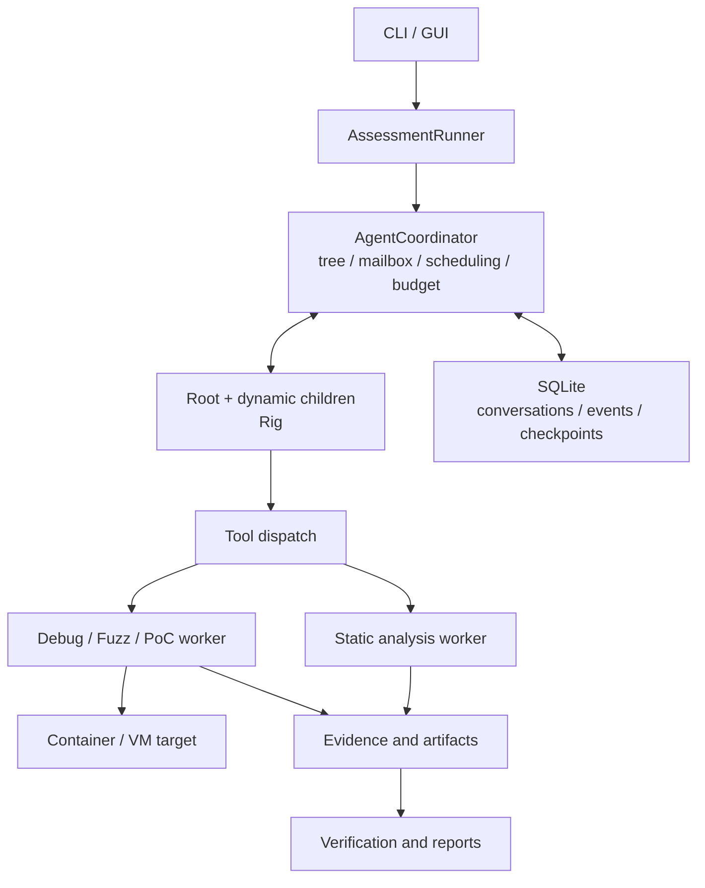

<a id="基于-strix-架构的-rust--rig-二进制逆向与利用验证-agent-方案"></a>

# Strix-inspired Rust / Rig binary reverse engineering and exploit verification plan

English · [简体中文](strix-rig-binary-agent-plan.zh-CN.md)

- Written: 2026-11-06.
- Status: historical requirements/design baseline; [architecture](../design/architecture.md) and [implementation contract](../design/implementation-contract.md) govern current implementation.
- Strix baseline: `06015506625a78b981ae0b34be40239fc1b389be`.
- Rig baseline: `v0.46.0`.
- Proposed first scope: Linux x86_64 ELF, source-unavailable samples, CLI/GUI, local experimental environments.

The implementation now uses native Rig ECS, session logs and SubagentsPlugin. Custom scheduler, AgentRun wrappers and create_agent below remain historical design descriptions. Model-facing creation is now task; business contracts/evidence acceptance remain project-owned. That refactor did not migrate old tasks.

<a id="1-项目目标与设计原则"></a>

## 1. Goals and principles

Rebuild the Strix module/runtime model in Rust + Rig, adding binary analysis, debugging, fuzzing and exploit verification. Alignment means root orchestration, dynamic children, messaging, durable conversations, sandbox execution, Skills and post-discovery verification/reporting. Binary-specific additions include debugger sessions, crash inputs, address references, primitives and reproduction environments.

Strix mappings came from reviewed source; binary-specific parts are proposals. Baselines: [Strix snapshot](https://github.com/usestrix/strix/tree/06015506625a78b981ae0b34be40239fc1b389be), [Rig v0.46.0](https://github.com/0xPlaygrounds/rig/releases/tag/v0.46.0). The controller is Rust; specialist Ghidra/IDA/debugger engines retain their environments behind workers/adapters. Windows PE/other architectures require backend extensions.

<a id="2-strix-到-rust-的模块映射"></a>

## 2. Strix-to-Rust mapping

| Strix module | Rust module | Responsibility |
|---|---|---|
| `interface/` | `interface` | CLI, GUI, run inspection, operator interaction |
| `agents/factory.py`, prompts | `agents` | Create Agents, compose roles/Skills |
| `core/runner.py`, `core/execution.py` | `runner` | Start, drive, retry, recover |
| `core/agents.py` | `coordinator` | Tree, states, mailboxes, parent relationships |
| `core/sessions.py`, `llm/compaction.py` | `session` | Persistence, checkpoints, compaction |
| `tools/` | `tools` | Typed tools, MCP, output handling |
| `runtime/` | `runtime` | Sandbox, workers, processes/resources |
| `skills/` | `skills` | Reverse-engineering methods, vulnerability knowledge, tool practice |
| `report/` | `report` | Findings, evidence, deduplication, coverage, reports |

Preserve coordination/lifecycle semantics:

| Interface | Expected behavior |
|---|---|
| `create_agent` | Create asynchronous child and return immediately; notify parent on completion |
| `send_message_to_agent` | Deliver mail, waking/processing at boundaries according to state |
| `wait_for_agents` | Event-driven wait for progress/completion |
| `view_agent_graph` | Inspect tree/scope/status to avoid duplicate work |
| `agent_finish` | Complete child work and report to parent |
| `finish_scan` | Finish root and summarize findings, coverage, unresolved work |

Sources: [root role](https://github.com/usestrix/strix/blob/06015506625a78b981ae0b34be40239fc1b389be/strix/skills/coordination/root_agent.md), [factory](https://github.com/usestrix/strix/blob/06015506625a78b981ae0b34be40239fc1b389be/strix/agents/factory.py), [coordination tools](https://github.com/usestrix/strix/blob/06015506625a78b981ae0b34be40239fc1b389be/strix/tools/agents_graph/tools.py).

<a id="3-总体架构与-rig-职责"></a>

## 3. Architecture and Rig responsibilities

Rig drives each Agent's reasoning/tool loop; the project's coordinator owns the whole assessment.



<a id="31-使用-rig-提供的能力"></a>

### 3.1 Rig capabilities

- Model/provider adapters.
- Typed tools, structured output and tool loops.
- Streaming events/hooks.
- `AgentRunner` single-run driver.
- Serializable `AgentRun` as a cross-process recovery foundation.

References: [architecture](https://rig.rs/docs/architecture), [AgentRunner](https://rig.rs/docs/concepts/agentrunner), [persistent runs](https://rig.rs/docs/concepts/runs).

<a id="32-项目自行实现的能力"></a>

### 3.2 Project-owned capabilities

- Dynamic tree, parent/child tasks, durable mailboxes.
- Deduplication, dependencies, resource scheduling.
- Shared target profiles, threat models, findings, coverage.
- Binary evidence/artifact model.
- Debugger, fuzz and sandbox lifecycle.
- Worker reconciliation/call deduplication across restarts.

Serializing Agent state cannot restore vanished debug processes. Recover model conversation, scheduling and external execution separately.

<a id="4-agent-角色与协作方式"></a>

## 4. Roles and collaboration

Root decomposes, coordinates and summarizes; children perform analysis. Compose role templates with Skills and create them by target/module/function/hypothesis.

| Role | Inputs/task | Required result |
|---|---|---|
| Binary Recon | Sample, launch, dependencies | Format, architecture, mitigations, input entry |
| Reverse Analyst | Functions, strings, xrefs | Logic, dataflow, candidate locations |
| Vulnerability Hunter | Entry/candidate paths | Hypotheses, triggers, unknowns |
| Fuzz Engineer | Format/path | Harness, seeds, background job |
| Crash Analyst | Crash input/run | Minimal sample, cause, grouping |
| Exploit Engineer | Confirmed issue/environment | Primitive, minimal PoC, applicability |
| Verifier | PoC/evidence bundle | Independent reproduction, failure conditions, conclusion |
| Reporter | Verified findings | Technical report, reproduction, remediation |

These historical templates may combine/split. Each task declares scope/completion criteria for deduplication. Preserve parent-history inheritance; retrieve large decompilation/dumps/logs by evidence ID. Share profiles/threat models/findings/coverage while each Agent retains its own conversation. Proposed states: running, waiting, budget_paused, completed, stopped, crashed, failed; stage one defines transitions/termination contracts.

<a id="5-二进制工具与后端"></a>

## 5. Tools and backends

<a id="51-首版工具选择"></a>

### 5.1 Initial choices

| Capability | Choice | Example interface |
|---|---|---|
| Binary profile | Rust `object` + checks | `binary.inspect`, `binary.mitigations` |
| Static reverse engineering | Ghidra worker | `functions.search`, `function.decompile`, `xrefs.query` |
| Debugging | GDB/MI worker | `debug.start`, `debug.breakpoint`, `debug.memory` |
| Binary-only fuzzing | AFL++ QEMU | `fuzz_start`, `fuzz_status`, `job_cancel` (worker `fuzz.start`/`fuzz.stop`) |
| Crash/PoC | Independent worker | `crash.replay`, `input.minimize`, `poc.verify` |
| Extensions | MCP/custom adapters | IDA, Windows debuggers, other engines |

`object` reads multiple binary formats; Ghidra headless hosts scripts with a project-written bridge; GDB/MI enables programmatic debugging; AFL++ QEMU instruments binary-only targets. References: [object](https://docs.rs/object/latest/object/), [Ghidra headless](https://github.com/NationalSecurityAgency/ghidra/blob/master/Ghidra/Features/Base/src/main/help/help/topics/HeadlessAnalyzer/HeadlessAnalyzer.htm), [GDB/MI](https://sourceware.org/gdb/current/onlinedocs/gdb.html/GDB_002fMI.html), [AFL++ QEMU](https://github.com/AFLplusplus/AFLplusplus/blob/stable/qemu_mode/README.md).

<a id="52-工具执行约束"></a>

### 5.2 Execution constraints

- **Ownership:** one worker serializes a debugger session; parallel experiments use independent targets.
- **Background jobs:** long fuzz tasks return job_id and advance by events/status queries.
- **Capabilities:** backends declare formats/architectures/operations and explicit unsupported states.
- **Bounded results:** summaries/references go to models, full decompilation/logs/dumps to storage.
- **Cache binding:** sample hash, tool version and configuration prevent cross-identity reuse.

<a id="6-数据模型与证据链"></a>

## 6. Data and evidence

Define from the first release:

| Entity | Fields |
|---|---|
| `Target` | SHA256, format, architecture, ABI, dependencies, argv, environment |
| `AddressRef` | Module, offset, address space, run instance |
| `Hypothesis` | Location, preconditions, inference, support, counterevidence |
| `ToolCall` | ID, argument summary, status, timeout, worker, artifacts |
| `Evidence` | Hash, source tool/version, environment, original result |
| `Finding` | Cause, impact, stage, PoC, limits, references |

Distinguish file offsets, module addresses and runtime addresses. Runtime references record load information/run instance to avoid ASLR/module confusion.

```text
Hypothesis → Construct input → Reproduce behavior → Confirm root cause
           → Verify primitive → Independently reproduce PoC → Report
```

Record evidence at each stage. Crashes, controlled read/write and code execution need separate verification; claim only achieved stages. Unconfirmed hypotheses stay unresolved; refutations retain reasons. Verifiers replay in clean environments, recording successes, dependencies/failures before promotion. Conditions include target/dependency versions, argv, input channel and environment. Coverage distinguishes static scope, executed paths and verified issues; reading a function is not dynamic testing.

<a id="7-运行时持久化与恢复"></a>

## 7. Runtime, persistence and recovery

<a id="71-控制端与执行环境"></a>

### 7.1 Controller and execution

Rust controller with isolated workers. Windows can control initial Linux ELF analysis; later PE debugging would add a Windows/DbgEng worker. Containers suit ordinary user-space experiments; use VMs for stronger isolation/kernel behavior. Inputs are read-only; Agents/experiments have separate output directories; model credentials remain on the controller. [DbgEng reference](https://learn.microsoft.com/en-us/windows-hardware/drivers/debugger/debugger-engine-overview).

<a id="72-预算与资源调度"></a>

### 7.2 Budgets and scheduling

Coordinator manages Agent count/depth, model budgets, duration, CPU/memory. Model and worker concurrency are separate, preventing fuzz/static jobs from monopolizing resources. Budget exhaustion, manual pause, failure and normal completion have distinct states; reports retain unfinished work.

<a id="73-持久化与恢复"></a>

### 7.3 Persistence and recovery

SQLite stores conversations/events/tasks/checkpoints; content-addressed directories hold large artifacts. Reconcile workers/background jobs before reconnecting/re-executing. Call IDs/state/results prevent duplicate effects. Recovery has three layers:

1. **Conversation:** history, Rig state, remaining budget.
2. **Coordination:** tree, mailboxes, relationships, dependencies, waits.
3. **External jobs:** reconcile debuggers, fuzzers, targets, sandboxes; reconnect or mark lost.

<a id="8-分阶段实施计划"></a>

## 8. Implementation stages

| Stage | Deliverables | Acceptance |
|---|---|---|
| 1. Strix alignment | Mapping, contracts, events/data | Separate direct migration from binary extensions |
| 2. Agent kernel | Rig, children, messaging, budgets, persistence | Async creation, wakeups, stop, restart |
| 3. Reverse-engineering loop | Import, Ghidra, GDB, evidence | Function analysis to input reproduction/root cause |
| 4. Verification loop | Fuzz, grouping, minimization, PoC, verifier | Independent reproduction/accurate impact |
| 5. Product delivery | GUI, reports, packaging, fixtures | Sustainable, traceable, replayable operation |

Stage one produces: module mapping; coordination/lifecycle contracts; conversation/task/finding/evidence/artifact models; worker protocol/capabilities/errors; initial evaluation/acceptance definitions. Then assemble Rig/runtime and integrate backends through the common protocol.

<a id="9-评测与验收"></a>

## 9. Evaluation and acceptance

Initial fixtures include symbol/stripped samples, known vulnerabilities, fixes and normal programs.

| Dimension | Metrics |
|---|---|
| Discovery | Accuracy, false positives, duplicates |
| Root cause | Location, trigger, dataflow explanation |
| Reproduction | Input/independent PoC success |
| Conclusions | Impact supported by corresponding evidence |
| Cost | Model cost, duration, CPU/memory |
| Recovery | Resume, duplicate execution, artifact integrity |

Key scenarios:

- `create_agent` returns while the child runs; completion notifies the parent.
- Multiple Agents never mutate one debugger concurrently.
- Fuzz jobs reconcile/reconnect after controller interruption.
- Resume does not unconditionally replay completed effects.
- Fixed/normal samples are not verified exploits based only on static suspicion.
- Final reports trace sample, environment, calls, raw artifacts and independent verification.

<a id="10-首版交付物"></a>

## 10. Initial deliverables

- Rust CLI/configuration.
- Dynamic coordination, persistence/recovery.
- Linux worker with Ghidra/GDB/AFL++ adapters.
- Profiling, reverse, crash, exploit-verification/report Skills.
- Replayable samples, environment descriptions, evidence/PoC bundles.
- Machine-readable results and analyst reports.
- Evaluation fixtures/run records for regression.
