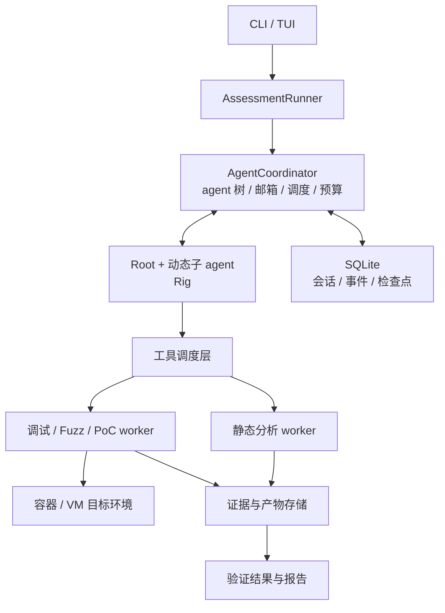

# 基于 Strix 架构的 Rust / Rig 二进制逆向与利用验证 Agent 方案

- 编写日期：2026-11-06
- 文档状态：历史需求与设计基线；当前实现以 [实现架构](architecture.md) 和 [实现契约](implementation-contract.md) 为准
- Strix 参照基线：`06015506625a78b981ae0b34be40239fc1b389be`
- Rig 参照基线：`v0.46.0`
- 首版建议范围：Linux x86_64 ELF、无源码样本、CLI / TUI、本地实验环境

当前版本已改用 Rig ECS 原生执行、会话日志和 SubagentsPlugin。下文的自定义调度器、AgentRun 包装及 create_agent 接口描述保留为设计历史；模型侧创建接口现为 task，业务契约与证据验收仍由项目实现。本次重构不包含旧任务迁移。

## 1. 项目目标与设计原则

以 Strix 的模块划分和运行语义为基线，用 Rust + Rig 重建 agent 系统，再加入二进制分析、动态调试、模糊测试和利用验证能力。

“完全参照 Strix”落实为模块和行为逐项对齐：保留根 agent 编排、动态子 agent、消息通信、持久化会话、沙箱执行、skills，以及发现后的验证与报告流程。二进制领域增加调试器会话、崩溃样本、地址引用、利用原语和复现环境等模型。

本方案中的 Strix 对应关系来自已核对的源码，二进制专用部分属于设计建议。基线链接：[Strix 源码快照](https://github.com/usestrix/strix/tree/06015506625a78b981ae0b34be40239fc1b389be)、[Rig v0.46.0](https://github.com/0xPlaygrounds/rig/releases/tag/v0.46.0)。

核心控制程序使用 Rust。Ghidra、IDA、调试器等专业引擎通过 worker 或适配器接入，保留各自运行环境。Windows PE 和其他架构通过后端扩展。

## 2. Strix 到 Rust 的模块映射

| Strix 模块 | Rust 对应模块 | 主要职责 |
|---|---|---|
| `interface/` | `interface` | CLI、TUI、运行查看、人工交互 |
| `agents/factory.py`、prompt | `agents` | 创建 agent、组合角色提示词与 skills |
| `core/runner.py`、`core/execution.py` | `runner` | 启动任务、驱动 agent、重试与恢复 |
| `core/agents.py` | `coordinator` | agent 树、状态、邮箱、父子关系 |
| `core/sessions.py`、`llm/compaction.py` | `session` | 会话持久化、检查点、上下文压缩 |
| `tools/` | `tools` | 类型化工具、MCP、工具输出管理 |
| `runtime/` | `runtime` | 沙箱、worker、进程与资源生命周期 |
| `skills/` | `skills` | 逆向方法、漏洞知识、工具操作规范 |
| `report/` | `report` | 发现、证据、去重、覆盖记录与报告 |

保留以下协调与生命周期接口的语义：

| 接口 | 预期行为 |
|---|---|
| `create_agent` | 创建异步子任务并立即返回；子任务完成后通知父 agent |
| `send_message_to_agent` | 向指定 agent 投递消息，按其状态唤醒或在运行边界处理 |
| `wait_for_agents` | 等待子任务进展或完成，通过事件唤醒 |
| `view_agent_graph` | 查看 agent 树、任务范围和运行状态，辅助避免重复工作 |
| `agent_finish` | 完成子 agent 任务并向父 agent 提交结果 |
| `finish_scan` | 结束根任务，汇总发现、覆盖记录和未解决事项 |

对应源码：[根 agent 设计](https://github.com/usestrix/strix/blob/06015506625a78b981ae0b34be40239fc1b389be/strix/skills/coordination/root_agent.md)、[agent 工厂](https://github.com/usestrix/strix/blob/06015506625a78b981ae0b34be40239fc1b389be/strix/agents/factory.py)、[协调工具](https://github.com/usestrix/strix/blob/06015506625a78b981ae0b34be40239fc1b389be/strix/tools/agents_graph/tools.py)。

## 3. 总体架构与 Rig 职责

Rig 负责单个 agent 的推理与工具循环；项目自己的协调器负责整个分析任务。



### 3.1 使用 Rig 提供的能力

- 模型与 provider 适配。
- 类型化工具、结构化输出和工具调用循环。
- 流式事件与 hooks。
- `AgentRunner` 单次运行驱动。
- 可序列化的 `AgentRun`，作为跨进程恢复的基础。

参考：[Rig 架构](https://rig.rs/docs/architecture)、[AgentRunner](https://rig.rs/docs/concepts/agentrunner)、[持久化运行机制](https://rig.rs/docs/concepts/runs)。

### 3.2 项目自行实现的能力

- 动态 agent 树、父子任务关系和持久化邮箱。
- 任务去重、依赖关系与资源调度。
- 共享目标画像、威胁模型、发现和覆盖记录。
- 二进制证据模型与产物管理。
- 外部调试器、fuzz 任务和沙箱生命周期。
- 跨进程恢复时的 worker 状态核对与调用去重。

序列化 agent 状态不能恢复已经消失的调试进程。恢复机制必须分别处理模型会话、调度状态和外部运行状态。

## 4. Agent 角色与协作方式

保留 Strix 根 agent 负责拆任务、协调和汇总的职责，具体分析由子 agent 执行。角色通过 skills 组合，按目标、模块、函数或漏洞假设动态创建。

| 角色 | 输入与任务 | 必须产生的结果 |
|---|---|---|
| Binary Recon | 样本、运行方式、依赖环境 | 格式、架构、保护机制、输入入口 |
| Reverse Analyst | 函数、字符串、交叉引用 | 关键逻辑、数据流、候选问题位置 |
| Vulnerability Hunter | 入口与候选路径 | 漏洞假设、触发条件、待验证项 |
| Fuzz Engineer | 输入格式与目标路径 | harness、种子、后台 fuzz 任务 |
| Crash Analyst | 崩溃输入与运行记录 | 最小样本、根因、崩溃分组 |
| Exploit Engineer | 已确认问题与环境约束 | 利用原语、最小 PoC、适用条件 |
| Verifier | PoC 与证据包 | 独立复现、失败条件、验证结论 |
| Reporter | 已验证发现 | 技术报告、复现步骤、修复建议 |

这些是角色模板，可以合并，也可以进一步拆分。每个任务声明目标范围和完成条件，协调器据此检查重复工作。

保留 Strix 的父历史继承能力。大段反编译结果、内存转储和日志通过证据 ID 按需读取，减少上下文占用。共享内容包括目标画像、威胁模型、发现和覆盖记录；每个 agent 保存自己的会话。

建议保留的 agent 运行状态包括：`running`、`waiting`、`budget_paused`、`completed`、`stopped`、`crashed`、`failed`。具体迁移规则和终止条件在第一阶段形成接口契约。

## 5. 二进制工具与后端

### 5.1 首版工具选择

| 能力 | 首版选择 | 对 agent 暴露的接口示例 |
|---|---|---|
| 二进制画像 | Rust `object` + 自定义检查 | `binary.inspect`、`binary.mitigations` |
| 静态逆向 | Ghidra worker | `functions.search`、`function.decompile`、`xrefs.query` |
| 动态调试 | GDB/MI worker | `debug.start`、`debug.breakpoint`、`debug.memory` |
| 无源码 fuzz | AFL++ QEMU 模式 | `fuzz_start`、`fuzz_status`、`job_cancel`（worker 协议对应 `fuzz.start`/`fuzz.stop`） |
| 崩溃与 PoC | 独立运行 worker | `crash.replay`、`input.minimize`、`poc.verify` |
| 扩展接入 | MCP / 自定义适配器 | IDA、Windows 调试器、其他分析引擎 |

`object` 提供多格式二进制读取接口。Ghidra headless 模式可以承载分析脚本，统一查询协议需要自行编写桥接层。GDB/MI 用于程序化调试，AFL++ QEMU 模式用于无源码二进制插桩。

参考：[object 文档](https://docs.rs/object/latest/object/)、[Ghidra headless 文档](https://github.com/NationalSecurityAgency/ghidra/blob/master/Ghidra/Features/Base/src/main/help/help/topics/HeadlessAnalyzer/HeadlessAnalyzer.htm)、[GDB/MI 文档](https://sourceware.org/gdb/current/onlinedocs/gdb.html/GDB_002fMI.html)、[AFL++ QEMU 文档](https://github.com/AFLplusplus/AFLplusplus/blob/stable/qemu_mode/README.md)。

### 5.2 工具执行约束

- **会话所有权：** 同一个调试器会话由一个 worker 顺序执行命令；并行实验使用独立目标进程。
- **后台任务：** fuzz 等长任务返回 `job_id`，通过事件和状态查询推进。
- **能力声明：** 后端声明支持的格式、架构和操作；不支持的能力返回明确状态，供 agent 调整任务。
- **结果有界：** 工具返回摘要和产物引用，完整反编译、日志和转储写入产物存储。
- **缓存绑定：** 分析缓存绑定样本哈希、工具版本和配置，防止跨样本或跨版本误用。

## 6. 数据模型与证据链

从第一版开始定义以下核心实体：

| 实体 | 关键字段 |
|---|---|
| `Target` | SHA256、格式、架构、ABI、依赖、启动参数、环境标识 |
| `AddressRef` | 模块标识、模块内偏移、地址空间、运行实例 |
| `Hypothesis` | 问题位置、前置条件、推断、支持证据、反证 |
| `ToolCall` | 调用 ID、参数摘要、状态、超时、worker、产物引用 |
| `Evidence` | 内容哈希、来源工具及版本、环境、原始结果 |
| `Finding` | 根因、影响、验证阶段、PoC、限制、证据引用 |

地址引用必须区分文件偏移、模块内地址和运行时地址。涉及运行时地址时，记录加载信息与运行实例，避免 ASLR 或模块变化导致定位错误。

建议的分析与验证流程：

```text
提出假设 → 构造输入 → 复现现象 → 确认根因
        → 验证利用原语 → 独立复现 PoC → 形成报告
```

每个阶段分别记录证据。崩溃复现、可控读写和代码执行分别验证，报告只能声明已经达到的阶段。无法确认的假设保留未决状态，已被反证的假设记录原因。

Verifier 在干净环境中重放，记录成功次数、依赖条件和失败情况，随后才能提升发现的验证状态。验证条件应包含目标和依赖版本、启动参数、输入方式及环境设置。

覆盖记录需要区分静态分析范围、实际执行路径和已验证问题。分析过某个函数，不等于该函数已经完成动态测试。

## 7. 运行时、持久化与恢复

### 7.1 控制端与执行环境

采用 Rust 控制端与隔离 worker。Windows 可以作为控制端，首版 ELF 动态分析放在 Linux 环境；后续 PE 调试增加 Windows worker，接入 DbgEng。

普通用户态实验可以采用容器，需要更强隔离或涉及内核行为时采用 VM。样本输入只读，agent 和实验分别保存输出目录，模型凭据留在控制端。

Windows 后端参考：[DbgEng 能力说明](https://learn.microsoft.com/en-us/windows-hardware/drivers/debugger/debugger-engine-overview)。

### 7.2 预算与资源调度

协调器统一管理 agent 数量、层级、模型预算、任务时限、CPU 和内存。模型调用并发与 worker 并发分别控制，避免 fuzz 和静态分析任务挤占全部执行资源。

预算耗尽、人工暂停、任务失败和正常完成采用不同状态，报告中保留未完成事项。

### 7.3 持久化与恢复

使用 SQLite 保存会话、事件、任务状态和检查点，使用按内容哈希组织的目录保存大型产物。

恢复时先核对 worker 和后台任务是否仍存活，再决定重新连接或重新执行。有副作用的工具调用通过调用 ID、任务状态和结果记录避免重复执行。

恢复分为三个层面：

1. **Agent 会话：** 恢复对话历史、Rig 运行状态和剩余预算。
2. **协调器：** 恢复 agent 树、邮箱、父子关系、任务依赖和等待状态。
3. **外部任务：** 核对调试器、fuzzer、目标进程和沙箱，恢复连接或标记任务已丢失。

## 8. 分阶段实施计划

| 阶段 | 交付内容 | 验收重点 |
|---|---|---|
| 1. Strix 行为对齐 | 模块映射、接口契约、事件与数据模型 | 明确直接迁移内容与二进制扩展 |
| 2. Agent 内核 | Rig、动态子 agent、消息、预算、持久化 | 异步创建、消息唤醒、停止、重启恢复 |
| 3. 逆向闭环 | 样本导入、Ghidra、GDB、证据查询 | 从函数分析推进到输入复现与根因定位 |
| 4. 利用验证闭环 | fuzz、崩溃去重、最小化、PoC、Verifier | 独立复现并输出准确的影响等级 |
| 5. 工具化交付 | TUI、报告、打包、评测集 | 可持续运行、可追踪、可重放 |

第一阶段的具体产物为：

1. Strix → Rust 模块映射表。
2. agent 协调接口与生命周期契约。
3. 会话、任务、发现、证据和产物数据模型。
4. worker 工具协议、能力声明和错误模型。
5. 首版评测集与验收定义。

这些产物确定后，搭建 Rig 与运行时骨架，再按统一协议接入各个逆向后端。

## 9. 评测与验收

首版评测集包含有符号与无符号样本、已知漏洞样本、修复版本和正常程序。

| 维度 | 关注指标 |
|---|---|
| 发现质量 | 发现准确率、误报、重复发现 |
| 根因分析 | 问题位置、触发条件和数据流解释是否正确 |
| 复现能力 | 输入复现率、PoC 独立复现成功率 |
| 结论准确性 | 声明的影响是否得到对应证据支持 |
| 运行成本 | 模型成本、运行时长、CPU 与内存占用 |
| 恢复可靠性 | 中断后任务恢复情况、重复执行、产物完整性 |

关键验收场景：

- `create_agent` 返回时子任务仍可以在后台运行，完成后父 agent 收到通知。
- 同一调试器会话不会被多个 agent 并发修改。
- fuzz 任务可以在控制端中断后被核对并重新连接。
- 恢复会话不会无条件重放已完成的有副作用工具调用。
- 修复版本和正常程序不会因单纯静态可疑特征被报告为已验证利用。
- 最终报告能追溯到样本、环境、工具调用、原始产物和独立验证记录。

## 10. 首版交付物

- Rust CLI 主程序与任务配置。
- 动态 agent 协调、持久化与恢复机制。
- Linux 分析 worker 运行环境及 Ghidra / GDB / AFL++ 适配器。
- 二进制画像、逆向、崩溃分析、利用验证与报告 skills。
- 可重放的样本、环境描述、证据和 PoC 产物包。
- 机器可读结果与面向分析人员的技术报告。
- 用于后续回归验证的评测集与运行记录。
