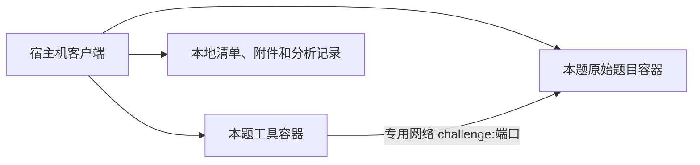

# Pwn 工作环境

## 已实现的结构

宿主机客户端管理 Docker。工具容器和题目容器并列，每道题有自己的工具数据卷和内部网络；容器内没有 Docker socket。工具镜像统一提供 GDB、Pwndbg、pwntools、Ghidra、angr、pwninit、patchelf、tmux、strace/ltrace、seccomp-tools 和 32 位运行支持。



当前发布范围是 Linux amd64 容器，Windows/Linux 宿主机。i386 用户态程序可运行。ARM、内核 Pwn、特殊内核版本、嵌套虚拟化不自动支持；不能把工具容器内跑通等同于原始题目环境验证。

## 首次使用

普通使用只需要 Docker 和预编译客户端，不需要在宿主机安装 Python、GDB 或 pwntools。Windows 在线发布包可用 `install-workbench.ps1` 安装到用户应用目录；它校验包内文件，并从 Docker Hub 拉取固定 digest 的镜像。私有仓库需要先登录有读取权限的账号。见 [在线安装](online-install.md)。

从源码构建时，先下载锁定依赖，再通过 Bake 一起构建基础镜像和工具镜像：

```powershell
python -m scripts.toolchain.fetch_worker_deps
docker buildx bake --load --set workbench.tags=re-agent-workbench:0.1
re-agent init re-agent.toml
re-agent --config re-agent.toml env up
re-agent --config re-agent.toml env doctor
```

Docker 不在 PATH 时，在配置的 `[runtime]` 设置 `docker_executable` 为完整路径。生成的配置位于工作环境目录的 `re-agent.toml`；使用它打开客户端，或在桌面“Pwn 环境”中选择“使用工具环境”。模型密钥仍通过宿主机凭据存储或环境变量提供。

`env doctor` 实际编译并运行 32/64 位程序，检查 GDB 断点、pwntools 收发、Python 分析库、Pwndbg/pwninit 和 Ghidra 导入，结果保存在 `doctor.json`。不是只检查可执行文件存在。

Windows 源码目录可能带 Low 完整性标记，直接运行其中生成的 EXE 会继承该标记并导致 Docker 管道拒绝访问。项目已有 `scripts/dev/publish-gui.ps1`，安装包也将程序复制到正常用户应用目录；按正式发布流程使用客户端，不需要修改 Docker 管道 ACL。

## 导入和准备题目

```powershell
re-agent challenge import C:/ctf/attachments --id demo --binary pwn
re-agent challenge show demo
re-agent challenge verify demo
re-agent challenge prepare demo
```

`--binary` 相对附件目录；只有一个 ELF 候选时可省略。导入建立：

```text
challenges/demo/
  original/                 原始附件及 SHA-256 清单
  challenge.toml            可编辑题目配置
  environment.lock.json     镜像、文件和构建身份
  prepared/                 提取、下载和准备的副本
  scripts/                  解题脚本
  results/                  构建与准备日志
  launch.json               统一启动配置
  re-agent.toml             本机专用客户端配置，不进入迁移包
```

后续构建、准备、启动前校验 `original/`。原件改变需要重新导入为新题。修改 `challenge.toml` 后重新准备；改变构建配置后重新构建。路径使用题目目录下的相对路径，不能越界。

示例配置（已导入题目里的路径包含 `original/`）：

```toml
schema_version = 1
id = "demo"
architecture = "X86_64"

[target]
binary = "original/pwn"

[runtime]
kind = "loader"
libc = "original/libc.so.6"
loader = "original/ld-linux-x86-64.so.2"
privileged = false

[launch]
argv = []
cwd = "original"
input = "stdin_pipe"
timeout_seconds = 10

[launch.env]
LANG = "C"

[network]
mode = "offline"
port = 1337
```

`argv_file` 输入模式必须在 argv 中包含 `@@`；`pty` 供交互会话使用。加载器、libc 和工作目录相同的声明由 LaunchSpec 统一提供给交互、调试、重放、最小化和验证。运行中通过映射再次确认 libc/loader。

指定 loader 时，工具生成稳定路径的 patchelf 运行副本，原始 binary/libc 不变。实际执行文件哈希可能不同于原始附件；两者不能混为一谈。每次执行使用独立、可写的工作目录副本，当前暂存限制为 1024 文件/32 MiB；大文件系统题使用原始服务或专门调试环境。

## 题目自带 Docker

```powershell
re-agent challenge import C:/ctf/docker题目 --id docker-demo --binary pwn
# 编辑 challenge.toml，确认 network.port、Dockerfile 和运行需求
re-agent challenge build docker-demo
re-agent challenge prepare docker-demo
re-agent challenge up docker-demo
re-agent challenge status docker-demo
```

Dockerfile 的构建上下文仅为本题原始附件；保留题目镜像的 ENTRYPOINT、CMD 和 USER。服务不发布宿主机端口。工具脚本连接 `remote("challenge", 1337)`，题目需要监听 `0.0.0.0` 等容器网络可达地址。

每题独立网络和工具容器，避免同时多题时服务别名冲突。题目容器没有项目数据库、模型密钥或工具数据卷。普通服务默认去除 capabilities；需要 jail/privileged 的题目必须在清单声明，并由操作者执行 `challenge up <id> --allow-privileged`。此类题目需要检查其权限和内核要求，不能假定与普通用户态题相同。

镜像内的主程序、libc、loader 可以不运行 ENTRYPOINT 就提取：

```powershell
re-agent challenge extract docker-demo --path /app/pwn --role binary
re-agent challenge extract docker-demo --path /usr/lib/x86_64-linux-gnu/libc.so.6 --role libc
re-agent challenge extract docker-demo --path /usr/lib/x86_64-linux-gnu/ld-linux-x86-64.so.2 --role loader
re-agent challenge prepare docker-demo
re-agent challenge export-rootfs docker-demo
```

提取路径必须是镜像内实际普通文件；遇到符号链接请指定解析后的路径。redpwn 风格镜像可能把真实根文件系统放在 `/srv`，需检查 Dockerfile，并提取 `/srv/...` 下的文件；`runtime.rootfs = "/srv"` 记录这一事实。完整 rootfs 导出为 tar，不会自动把它转换为等价调试环境。

需要完整题目文件系统的人工调试可以运行 `re-agent challenge debug docker-demo`。它创建独立工具调试容器，仅共享该题服务的 PID namespace；返回可附加的容器内 PID。按返回提示运行 GDB，并设置 `sysroot=/proc/<PID>/root` 读取该进程的真实文件系统。它不共享宿主机 PID namespace。调试会影响原服务进程，结束后重新启动原始题目服务再做最终验证。特殊 jail 的 namespace/权限限制仍可能阻止附加。

网络连接只提供服务输入输出。最终利用脚本应回到原始题目服务验证；本地 GDB 的成功不代表 jail、seccomp、文件布局和网络协议都相同。

## 远程、符号与人工使用

远程题设置：

```toml
[network]
mode = "remote"
host = "ctf.example.org"
port = 31337
```

`challenge up` 创建固定目标 TCP relay。工具容器仍只连接内部网络，通过 `challenge:31337` 到达指定服务；relay 单独连接出口网络。这是 TCP 转发，不支持 UDP 或任意代理目标。

`re-agent challenge pwninit demo` 在可联网的临时容器内，以非 root 用户对附件副本运行 pwninit，限时 180 秒。优先按 Build-ID 使用工具镜像已有的调试符号，未命中才由 pwninit 下载。输出保存为 `prepared/pwninit-*/`，不会自动替换选定运行库。下载调试符号、unstrip 可能改变副本哈希，应比对 Build-ID；失败日志位于 `results/pwninit.log`。离线环境应携带已经准备好的文件。

人工操作可用 `docker exec -it <本题工具容器> bash` 进入工具箱；容器名由 `challenge status` 返回。自动 agent 使用 UID 隔离执行，操作者的手工 root shell 拥有该工具容器的管理权限。

## 更新、停止和迁移

```powershell
re-agent env status
re-agent env update --image <新的工具镜像或镜像ID>
re-agent env rollback
re-agent challenge down demo
re-agent env down
re-agent env export C:/transfer/pwn-workbench
```

环境启动后固定镜像 ID，重新启动不会自动跟随浮动标签升级。工具环境更新记录上一镜像，失败尝试恢复；题目工具容器使用自己的既有镜像，重新创建时采用当前工具镜像。`env down` 停止主工具容器；每题使用 `challenge down` 单独停止并删除容器/网络及其匿名卷，保留题目文件和工具的命名数据卷。

迁移包是目录，包含 `bundle.json`、`images.tar`、题目文件、命名卷 tar 和历史分析快照。导出先拒绝已登记的活动任务/会话，停止相关容器取得卷快照，结束后恢复原先运行的容器。手工 shell/GDB 不在自动会话登记中，导出前先结束。哈希覆盖包内文件。初次完整镜像约 11 GB，应预留空间；跨机器复制完成后，在新机器的**空工作环境目录**导入：

```powershell
re-agent --config 新机器配置.toml env import D:/transfer/pwn-workbench
re-agent --config 新机器配置.toml env doctor
re-agent --config 新机器配置.toml challenge up demo
```

导入重建本机容器名、网络和客户端配置；不复活旧 PID、调试会话和 worker 认证 token。历史 SQLite 和证据保存在 `history/` 供只读查询，不把旧绝对路径的任务直接恢复执行。新任务使用新机器配置。服务容器的可写层和匿名卷不迁移，服务按原镜像重建。凭据存储、宿主机配置文件不打包；题目附件、脚本和历史内容本身仍应按私有数据保管。

## 验证范围和边界

已经覆盖原件变更检测、路径越界、工作区锁、SQLite WAL 快照、归档穿越拒绝、会话状态清理，以及真实 Docker 的两题隔离、固定目标转发、卷恢复、指定 libc 的交互/GDB/重放和 PTY 交互。

尚不提供：内核/ARM 环境自动重建、任意 Compose 多服务拓扑导入、任意 jail 内层 namespace 自动附加、PTY 自动崩溃重放、历史运行的跨机器无缝续跑。APT/Python 全依赖没有完全锁死；迁移的可重复性依赖已验证的镜像 ID 和离线镜像，不能宣称任意日期从源码重建会得到同一镜像。

验收脚本：`python tests/acceptance/check_workbench.py --docker <docker路径>`。这是开发验收工具，不是日常运行依赖，也不是 Pwn 题库评测套件。
