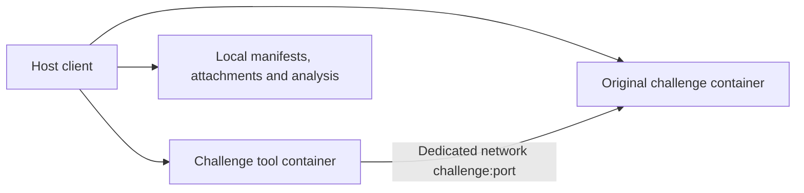

<a id="pwn-工作环境"></a>

# Pwn workbench

English · [简体中文](pwn-workbench.zh-CN.md)

<a id="已实现的结构"></a>

## Implemented architecture

The host client manages Docker. Tool and challenge containers are siblings; each challenge has its own tool-data volume and internal network. No container receives the Docker socket. The tool image includes GDB, Pwndbg, pwntools, Ghidra, angr, pwninit, patchelf, tmux, strace/ltrace, seccomp-tools and 32-bit runtime support.



Current releases support Linux amd64 containers on Windows/Linux hosts, including i386 user-space programs. ARM, kernel Pwn, special kernels and nested virtualization are not automatically supported. Success in a tool container is not verification in the original challenge environment.

<a id="首次使用"></a>

## First use

Normal use needs Docker and the prebuilt client, not host Python/GDB/pwntools. Windows uses an installer EXE; Linux uses AppImage. First-run setup pulls the release's fixed digest from public `hlmark0/wukong` and runs self-tests. See [online installation](online-install.md).

For source builds, download locked dependencies, then Bake the base and workbench images together:

```powershell
python -m scripts.toolchain.fetch_worker_deps
docker buildx bake --load --set workbench.tags=wukong:0.1
wukong init wukong.toml
wukong --config wukong.toml env up
wukong --config wukong.toml env doctor
```

If Docker is absent from PATH, set `[workbench].docker_executable` to its absolute path. Generated configuration is `wukong.toml` in the workbench directory and registers the named `workbench` Linux environment; open the client with it or select **Use tool environment** in the desktop. Model credentials still come from host credential storage/environment variables.

`env doctor` compiles/runs 32/64-bit programs and checks GDB breakpoints, pwntools I/O, Python libraries, Pwndbg/pwninit and Ghidra import. Results go to `doctor.json`; it does more than check executable presence.

Windows source directories may carry Low integrity labels inherited by built EXEs, causing Docker pipe access denial. `scripts/dev/publish-gui.ps1` and installers copy programs to normal user application directories. Follow deployment instructions rather than changing Docker pipe ACLs.

<a id="导入和准备题目"></a>

## Import and prepare a challenge

```powershell
wukong challenge import C:/ctf/attachments --id demo --binary pwn
wukong challenge show demo
wukong challenge verify demo
wukong challenge prepare demo
```

`--binary` is relative to attachments and is optional when there is one ELF candidate. Import creates:

```text
challenges/demo/
  original/                 Original attachments and SHA-256 manifest
  challenge.toml            Editable challenge configuration
  environment.lock.json     Image, file and build identities
  prepared/                 Extracted, downloaded and prepared copies
  scripts/                  Solution scripts
  results/                  Build and preparation logs
  launch.json               Unified launch configuration
  wukong.toml               Machine-specific client configuration, not migrated
```

Build/preparation/start verify `original/`. Changed originals require import as a new challenge. Reprepare after editing `challenge.toml`; rebuild after build-configuration changes. Paths must stay relative and inside the challenge directory.

Example (imported paths include `original/`):

```toml
schema_version = 1
id = "demo"
architecture = "X86_64"

[target]
binary = "original/pwn"

[runtime]
kind = "loader"
libc = "original/libc.so.6"
loader = "original/ld-linux-x86-64.so.2"
privileged = false

[launch]
argv = []
cwd = "original"
input = "stdin_pipe"
timeout_seconds = 10

[launch.env]
LANG = "C"

[network]
mode = "offline"
port = 1337
```

`argv_file` mode requires `@@` in argv; `pty` supports interactive sessions. LaunchSpec supplies consistent loader/libc/working-directory declarations to interaction, debugging, replay, minimization and verification. Confirm actual libc/loader mappings again at runtime.

Background `job_start` also accepts the staged LaunchSpec with an optional staged input. The manifest supplies argv, environment, cwd and timeout, so omit per-call overrides. Process jobs support `stdin_pipe` and `argv_file`; use an interactive session for `pty`. Preparation records regular files from cwd, and isolated execution stages only declared members while preserving paths outside cwd. Symlinks must be resolved before preparation.

When a loader is specified, tools create a stable-path patchelf execution copy without changing original binary/libc. Executed-file hashes may differ from attachment hashes; keep identities separate. Each execution uses a separate writable working-directory copy, currently limited to 1024 files/32 MiB. Use original services/dedicated debugging environments for large filesystems.

<a id="题目自带-docker"></a>

## Challenges with Docker

```powershell
wukong challenge import C:/ctf/docker-challenge --id docker-demo --binary pwn
# Edit challenge.toml; confirm network.port, Dockerfile and runtime requirements
wukong challenge build docker-demo
wukong challenge prepare docker-demo
wukong challenge up docker-demo
wukong challenge status docker-demo
```

Build context contains only this challenge's original attachments. The image's ENTRYPOINT, CMD and USER are preserved. Service ports are not published on the host. Tool scripts use `remote("challenge", 1337)`; the service must listen on a container-network-reachable address such as `0.0.0.0`.

Per-challenge networks/tool containers prevent alias collisions across simultaneous challenges. Challenge containers receive no project database, model credentials or tool-data volume. Ordinary services drop capabilities by default. Jail/privileged requirements must be declared in the manifest and explicitly started using `challenge up <id> --allow-privileged`; inspect their permissions/kernel requirements instead of assuming ordinary user-space behavior.

Extract binary/libc/loader without running ENTRYPOINT:

```powershell
wukong challenge extract docker-demo --path /app/pwn --role binary
wukong challenge extract docker-demo --path /usr/lib/x86_64-linux-gnu/libc.so.6 --role libc
wukong challenge extract docker-demo --path /usr/lib/x86_64-linux-gnu/ld-linux-x86-64.so.2 --role loader
wukong challenge prepare docker-demo
wukong challenge export-rootfs docker-demo
```

Extraction requires actual regular files; resolve symlinks first. redpwn-style images may place the real root filesystem under `/srv`; inspect the Dockerfile and extract `/srv/...`. `runtime.rootfs = "/srv"` records this layout. A full rootfs tar export does not automatically become an equivalent debugging environment.

For manual debugging requiring the complete filesystem, run `wukong challenge debug docker-demo`. It creates a separate tool-debug container sharing only that service's PID namespace and returns an attachable container PID. Follow the returned GDB instructions and set `sysroot=/proc/<PID>/root` for the process's actual filesystem. Host PID namespace is not shared. Debugging affects the original service; restart it before final verification. Special jail namespace/permission restrictions may still prevent attachment.

Networking provides service I/O only. Verify final exploit scripts against the original service; local GDB success does not establish identical jail, seccomp, filesystem or protocol conditions.

<a id="远程符号与人工使用"></a>

## Remote services, symbols and manual use

Remote configuration:

```toml
[network]
mode = "remote"
host = "ctf.example.org"
port = 31337
```

`challenge up` creates a fixed-target TCP relay. Tools remain on an internal network and reach the specified service through `challenge:31337`; the relay alone joins an egress network. This is TCP forwarding, not UDP or an arbitrary-target proxy.

`wukong challenge pwninit demo` runs pwninit as non-root on attachment copies in a temporary internet-connected container, with a 180-second timeout. It prefers image-provided debug symbols by Build-ID, downloading through pwninit only on a miss. Output goes to `prepared/pwninit-*/` without automatically replacing selected runtime libraries. Symbol downloads/unstrip can change copy hashes; compare Build-ID. Failure logs are in `results/pwninit.log`. Carry already-prepared files when offline.

Enter tools manually with `docker exec -it <challenge-tool-container> bash`; `challenge status` supplies the name. Automatic Agents run under UID isolation; an operator's root shell has tool-container administrative permissions.

<a id="更新停止和迁移"></a>

## Update, stop and migrate

```powershell
wukong env status
wukong env update --image <new-tool-image-or-image-ID>
wukong env rollback
wukong challenge down demo
wukong env down
wukong env export C:/transfer/pwn-workbench
```

Starting pins an image ID; restarts do not track floating tags. Updates record the previous image and attempt recovery on failure. Existing challenge tool containers keep their image; recreation uses the current tool image. `env down` stops the main tool container. `challenge down` separately stops/removes that challenge's containers, networks and anonymous volumes, retaining files and named tool-data volumes.

A migration directory contains `bundle.json`, `images.tar`, challenge files, named-volume tars and historical analysis snapshots. Export refuses registered active tasks/sessions, stops related containers for volume snapshots and restores previously running containers afterward. Manual shells/GDB are not automatically registered; close them first. Hashes cover bundle files. The initial full image is approximately 11 GB; reserve space. After copying, import into an **empty workbench directory** on the new machine:

```powershell
wukong --config new-machine.toml env import D:/transfer/pwn-workbench
wukong --config new-machine.toml env doctor
wukong --config new-machine.toml challenge up demo
```

Import rebuilds machine-local names, networks and client configuration, never old PIDs, debugger sessions or worker authentication tokens. Historical SQLite/evidence remain read-only under `history/`; tasks with old absolute paths are not resumed directly. New tasks use new-machine configuration. Service writable layers/anonymous volumes are not migrated; services rebuild from original images. Host configuration/credential stores are excluded; attachments, scripts and history themselves still require private-data handling.

<a id="验证范围和边界"></a>

## Validation scope and limits

FILE, exit-handler, seccomp I/O, input-constraint and musl methods load on demand; hidden allocations and GC object invariants extend existing methods. See [Pwn knowledge sources](../reference/pwn-knowledge.md) for applicability.

`seccomp_analyze` parses saved filters and probes concrete calls. `libc_identify` compares supplied libc candidates. Network `poc_verify` performs bounded multi-round TCP replay through prepared challenge endpoints, preserving each connection's leaks, payload patches and original I/O. See [Pwn evidence tools](../reference/pwn-tools.md). It does not reset services or confirm remote runtime identity.

Coverage includes original-file change detection, path boundaries, workspace locking, SQLite WAL snapshots, archive traversal rejection, session cleanup, and real-Docker two-challenge isolation, fixed-target forwarding, volume restoration, specified-libc interaction/GDB/replay and PTY interaction.

Not provided: automatic kernel/ARM reconstruction, arbitrary Compose multi-service import, automatic attachment to arbitrary nested jail namespaces, PTY crash replay, or seamless cross-machine resume of historical runs. APT/Python transitive dependencies are not fully locked. Migration repeatability relies on verified image IDs/offline images; source rebuilds on arbitrary dates are not guaranteed identical.

Acceptance entry: `python tests/acceptance/check_workbench.py --docker <docker-path>`. This is a development acceptance tool, not a daily runtime requirement or a Pwn challenge benchmark suite.
